<div align="center">
  

  <h1>ASMRTranslator Studio</h1>

  <p><b>日文 ASMR / 同人音声 AI 语音识别、中文字幕生成与中文配音桌面工具</b></p>
  <p><i>Japanese ASMR &amp; Voice Drama AI Transcription, Subtitle Translation &amp; Chinese Dubbing Studio</i></p>

  <p>
    <a href="https://github.com/wanasummer/ASMRTranslator-bin/releases/latest"></a>
    <a href="https://github.com/wanasummer/ASMRTranslator-bin/releases/latest"></a>
    <a href="https://github.com/wanasummer/ASMRTranslator-backend"></a>
    <a href="https://gitee.com/SummerXZ/asmrtranslator-plugin"></a>
  </p>

  <p>
    <a href="#下载最新版"><b>⬇️ 下载最新版</b></a> ·
    <a href="#v161-更新说明对比-v157"><b>✨ v1.6.1 更新说明</b></a> ·
    <a href="使用教程.md"><b>📖 图文使用教程</b></a> ·
    <a href="#界面展示"><b>🖼️ 界面展示</b></a> ·
    <a href="https://gitee.com/SummerXZ/asmrtranslator-plugin"><b>🧩 本地插件下载</b></a> ·
    <a href="#常见问题"><b>❓ 常见问题</b></a>
  </p>
</div>

---

## 它是什么？能解决什么问题？

**ASMRTranslator Studio** 是一款专为 **日文 ASMR / 同人音声** 打造的 Windows 本地桌面工具。无需懂日语、无需现成字幕，导入音频即可**自动语音识别（ASR）+ 大模型翻译生成中文字幕**，并支持一键制作**中文配音**与**可视化时间轴编排**。

| 🎧 听不懂日语、找不到字幕 | 🌙 想闭眼助眠、不想盯屏幕 | 🎚️ 已有字幕想精修或二创配音 |
| --- | --- | --- |
| 直接导入日文音声（MP3 / WAV / M4A / OGG 等），自动检测人声区间、识别日语并翻译为中文字幕（WebVTT），支持整部作品文件夹批量处理。 | 内置多套在线与本地克隆配音引擎，可将中文字幕合成为中文语音；独创**「潜意识同传」**模式 100% 保留原声，在耳边低音量轻柔叠加中文耳语。 | 支持导入 VTT / SRT / LRC 字幕，在**音频编排工作台**中对照双轨波形逐句试听、微调时间轴、单独调整每句音色与语速，一键导出高音质成品并自动嵌入封面。 |

> 📖 **[查看完整图文使用教程](使用教程.md)**（从安装配置、模型接入到字幕生成、音频编排、中文配音与批量导出）
> 🧩 **插件安装器及本地模型下载**：[ASMRTranslator Plugin 仓库](https://gitee.com/SummerXZ/asmrtranslator-plugin)

---

## 下载最新版

| 版本 | 安装包 | 大小 | 发布日期 | 下载 |
| --- | --- | --- | --- | --- |
| **v1.6.1** | `ASMRTranslator.Studio_1.6.1_x64-setup.exe` | 约 128.24 MiB | 2026-11-22（北京时间） | [下载安装包](https://github.com/wanasummer/ASMRTranslator-bin/releases/download/v1.6.1/ASMRTranslator.Studio_1.6.1_x64-setup.exe) |

[查看 v1.6.1 发布页](https://github.com/wanasummer/ASMRTranslator-bin/releases/tag/v1.6.1) · [下载校验文件](https://github.com/wanasummer/ASMRTranslator-bin/releases/download/v1.6.1/ASMRTranslator.Studio_1.6.1_x64-setup.exe.sha256)

SHA-256：

```text
7B72D860FF8760F0C5E753181E772391A7294AD52EF7BCF806AFA688CA6ED166
```

> 当前安装包尚未进行代码签名。Windows SmartScreen 可能显示“未知发布者”，请核对文件名和 SHA-256 后再运行。

---

## v1.6.1 更新说明（对比 v1.5.7）

### 新功能与体验改进

- **新增 DeepSeek ASR 与 Fish Audio `drama-3` 模型**：接入 DeepSeek 语音识别接口（可在无字幕识别方案中选用，支持连接预检）；Fish Audio 新增高表现力付费模型 `drama-3`，进一步提升角色情感与戏剧化朗读效果。
- **全新音频编排工作台**：支持可视化查看原声全局分段与句子块、添加空白片段、分组与合并片段编辑、单段/全局试听，以及「保留原声」双时间轴编辑与分段过渡播放。
- **逐句独立配音与指令式字幕优化**：编排工作台支持为单个片段独立配置 TTS 音色与参数；新增基于提示词指令的全局字幕优化，可一键按要求整体润色译文。
- **识别与对齐能力增强**：新增 **MOSS** 语音识别与字幕精修管线、**ASR Boost** 增强检测通道与 **ASMR VAD** 本地插件自动发现，并新增「过滤非日语识别」开关，减少杂音与误识别。
- **UVR 人声分离支持**：支持配置远程 UVR 人声分离分析并查看分离进度，分离后的人声可直接用于逐段音色参考，减少背景音对克隆音色的干扰。
- **打开音频即项目**：无需先手动新建项目，在首页或项目页直接选择音频或「选择当前文件夹」即可自动建立项目、递归扫描音频并匹配同目录字幕。
- **高音质导出与自动封面嵌入**：实验设置新增「导出高音质」开关，一键导出时自动保留原音频标签并从项目目录匹配封面图片嵌入 MP3，结果页新增快捷导出入口。
- **项目数据统一管理**：每个项目的字幕、编排草稿、缓存与运行记录统一保存在项目 `generated/` 目录中（全新存储格式不兼容旧版项目文件）。

### 修复与稳定性改进

- 修复设置页服务连接模式（本机/服务器等）切换后未能显式持久化保存的问题。
- 修复多种文本编码（UTF-8/16/32、GBK、Shift-JIS 等）字幕导入时的乱码与解析失败问题。
- 修复保留原声试听起点异常、大倍率变速播放卡顿、合并块边界丢失及刷新渲染片段异常的问题。
- 修复一键导出时最终字幕时间轴丢失、项目草稿与导出记录恢复异常的问题。
- 修复插件旧参数迁移兼容问题与文件被占用时的错误提示。

---

## 四种听感模式

同一份音声与字幕，可自由输出四种完全不同的听音体验：

| 模式 | 效果说明 | 适用场景 |
| --- | --- | --- |
| **1. 仅替换原声** | 用中文配音完全替换对应的日文原声片段 | 想听纯中文版、无需对照原声 |
| **2. 保留原声 · 对照** | 先放一句日文原声，短暂停顿后再放中文配音 | 边听原声边理解剧情、日语学习 |
| **3. 声音同步叠加** | 中文配音与日文原声同时播放（支持「跟随原声」或「跟随翻译」节奏） | 希望画面/字幕与声音严格同步 |
| **4. 潜意识同传（特色）** | **100% 保留原声**，中文翻译经低音量、延迟浮现、混响与齿音柔化后叠在底下 | 助眠、沉浸享受原声又想隐约听懂内容 |

---

## 主要功能

- **只生成字幕 / 完整配音自由切换**：默认仅生成高质量中文字幕（WebVTT），无需配置 TTS；需要中文配音时再选择配音引擎。
- **多引擎与本地克隆**：支持微软 Edge TTS（免费免 Key）、小米 MiMo TTS、Fish Audio、MiniMax，以及通用 TTS 插件（Audio8 TTS、IndexTTS 2.5、Genie TTS）。
- **多方案日语语音识别（ASR）**：支持 DeepSeek ASR、Fish ASR、千问 Qwen-Audio / Fun-ASR、小米 MiMo ASR（日语实验）、MOSS、Kotoba-Whisper、Parakeet 及 ChickenRice（海南鸡）字幕服务，配合本地 FSMN-VAD / ASMR VAD 精准切句。
- **项目化与批量任务中心**：直接导入单个文件或整个作品文件夹，支持任务队列、批次启停、逐段断点缓存复用、实时插件日志与一键批量导出。
- **智能响度与防爆音处理**：每句配音自动对齐原声响度，支持语速、翻译音量、交叉淡化与 TTS 伪影检测。

---

## 快速上手（6 步完成）

1. 下载并安装 **ASMRTranslator Studio**。
2. 在首页或项目页直接选择音频文件，或点击「选择当前文件夹」批量导入多段音频（同目录 VTT / SRT / LRC 字幕会自动匹配）。
3. 若无现成字幕，在设置页配置 ASR 语音识别与文字大模型翻译接口。
4. 默认仅生成中文字幕；如需中文配音，在工作台选择 TTS 引擎、音色与听感模式。
5. 将音频加入任务队列并启动处理，可在任务中心实时查看进度与日志；需要精修时可进入编排工作台逐句试听调整。
6. 完成后在结果页预览字幕与音频，或使用一键导出批量输出 MP3 与 WebVTT 字幕。

---

## 界面展示

使用示例项目，每行两张，点击图片查看原图 · [查看完整总览](assets/tutorial/overview-4x4.jpg)

<table width="100%" style="display: table; width: 100%; table-layout: fixed; border-collapse: separate; border-spacing: 4px; border: 0;">
  <tr style="border: 0; background: transparent;">
    <td width="50%" align="center" style="border: 0; padding: 0; vertical-align: top;"><a href="assets/tutorial/01-home.png" style="display: block; position: relative; aspect-ratio: 8 / 5; box-sizing: border-box; border: 1px solid #d0d7de; padding: 6px; overflow: hidden;">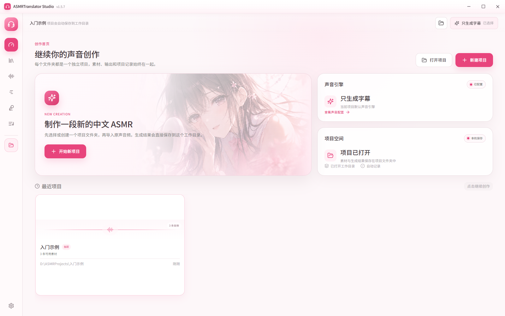</a><p style="font-size: 12px; line-height: 1.5; text-align: center; margin: 4px 0 8px;">首页与项目入口</p></td>
    <td width="50%" align="center" style="border: 0; padding: 0; vertical-align: top;"><a href="assets/tutorial/02-project.png" style="display: block; position: relative; aspect-ratio: 8 / 5; box-sizing: border-box; border: 1px solid #d0d7de; padding: 6px; overflow: hidden;">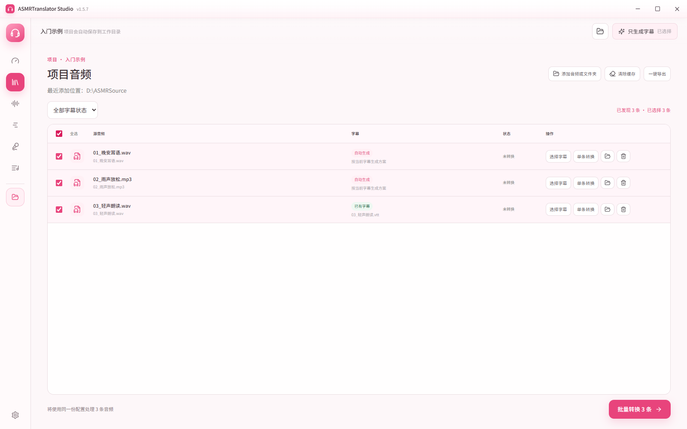</a><p style="font-size: 12px; line-height: 1.5; text-align: center; margin: 4px 0 8px;">素材导入与批量选择</p></td>
  </tr>
  <tr style="border: 0; background: transparent;">
    <td width="50%" align="center" style="border: 0; padding: 0; vertical-align: top;"><a href="assets/tutorial/03-settings-llm.png" style="display: block; position: relative; aspect-ratio: 8 / 5; box-sizing: border-box; border: 1px solid #d0d7de; padding: 6px; overflow: hidden;">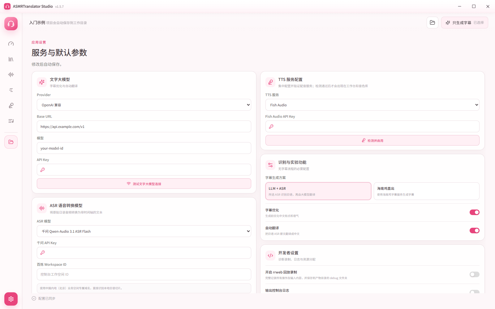</a><p style="font-size: 12px; line-height: 1.5; text-align: center; margin: 4px 0 8px;">文字大模型与在线识别</p></td>
    <td width="50%" align="center" style="border: 0; padding: 0; vertical-align: top;"><a href="assets/tutorial/04-settings-asr.png" style="display: block; position: relative; aspect-ratio: 8 / 5; box-sizing: border-box; border: 1px solid #d0d7de; padding: 6px; overflow: hidden;">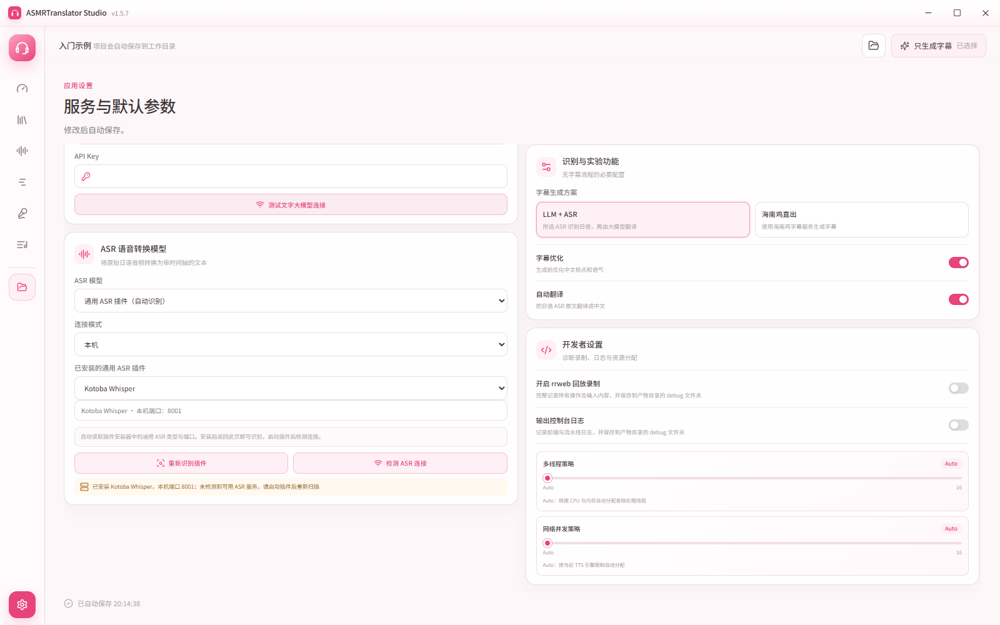</a><p style="font-size: 12px; line-height: 1.5; text-align: center; margin: 4px 0 8px;">通用 ASR 插件</p></td>
  </tr>
  <tr style="border: 0; background: transparent;">
    <td width="50%" align="center" style="border: 0; padding: 0; vertical-align: top;"><a href="assets/tutorial/05-settings-chickenrice.png" style="display: block; position: relative; aspect-ratio: 8 / 5; box-sizing: border-box; border: 1px solid #d0d7de; padding: 6px; overflow: hidden;">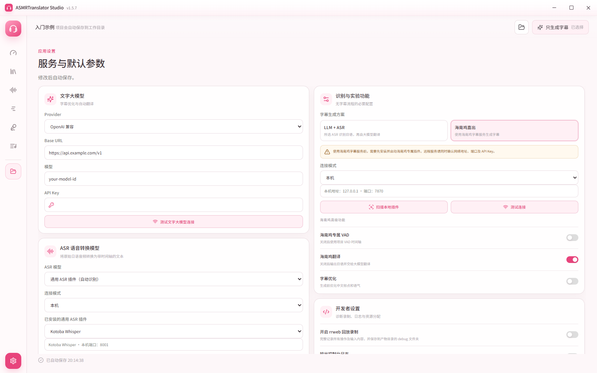</a><p style="font-size: 12px; line-height: 1.5; text-align: center; margin: 4px 0 8px;">海南鸡字幕方案</p></td>
    <td width="50%" align="center" style="border: 0; padding: 0; vertical-align: top;"><a href="assets/tutorial/06-settings-common-tts.png" style="display: block; position: relative; aspect-ratio: 8 / 5; box-sizing: border-box; border: 1px solid #d0d7de; padding: 6px; overflow: hidden;">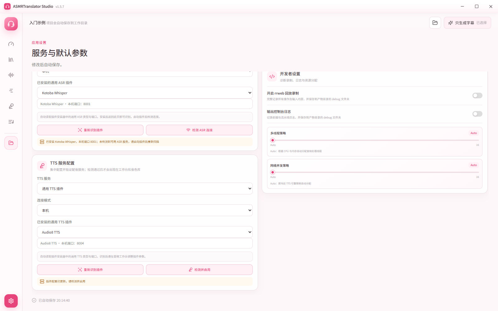</a><p style="font-size: 12px; line-height: 1.5; text-align: center; margin: 4px 0 8px;">通用 TTS 插件</p></td>
  </tr>
  <tr style="border: 0; background: transparent;">
    <td width="50%" align="center" style="border: 0; padding: 0; vertical-align: top;"><a href="assets/tutorial/07-studio-subtitles.png" style="display: block; position: relative; aspect-ratio: 8 / 5; box-sizing: border-box; border: 1px solid #d0d7de; padding: 6px; overflow: hidden;">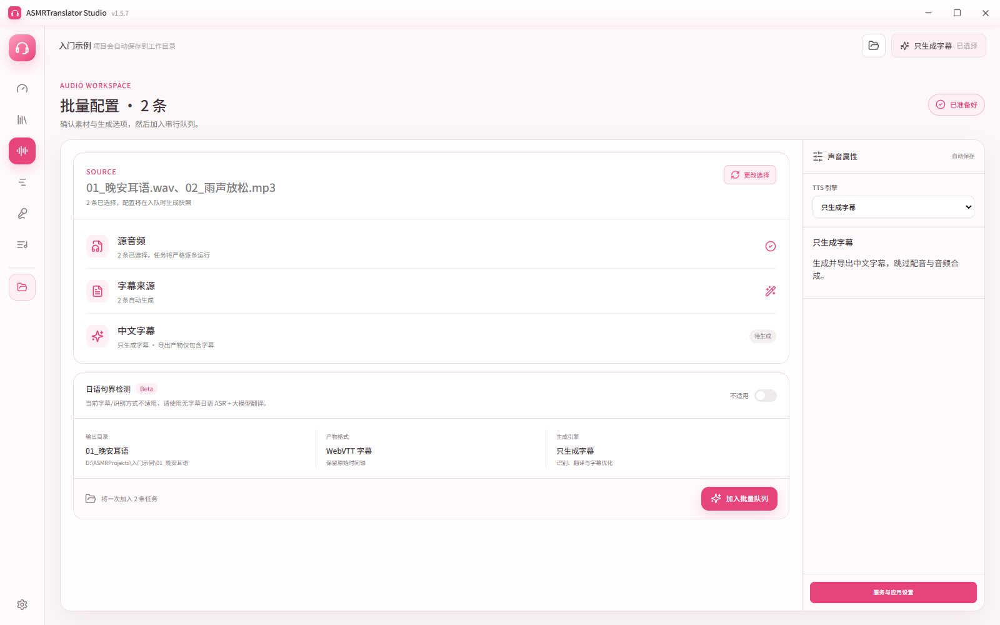</a><p style="font-size: 12px; line-height: 1.5; text-align: center; margin: 4px 0 8px;">只生成中文字幕</p></td>
    <td width="50%" align="center" style="border: 0; padding: 0; vertical-align: top;"><a href="assets/tutorial/08-studio-edge.png" style="display: block; position: relative; aspect-ratio: 8 / 5; box-sizing: border-box; border: 1px solid #d0d7de; padding: 6px; overflow: hidden;">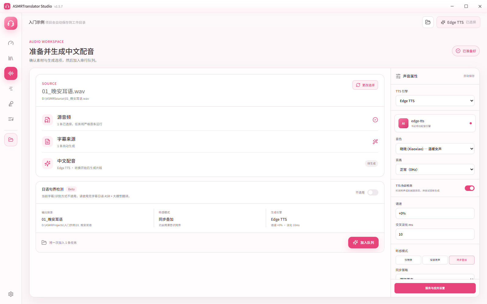</a><p style="font-size: 12px; line-height: 1.5; text-align: center; margin: 4px 0 8px;">中文配音与听感</p></td>
  </tr>
  <tr style="border: 0; background: transparent;">
    <td width="50%" align="center" style="border: 0; padding: 0; vertical-align: top;"><a href="assets/tutorial/09-studio-indextts.png" style="display: block; position: relative; aspect-ratio: 8 / 5; box-sizing: border-box; border: 1px solid #d0d7de; padding: 6px; overflow: hidden;">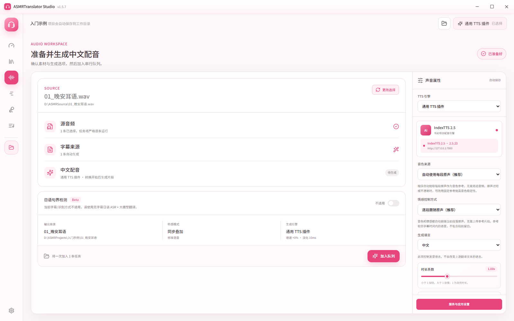</a><p style="font-size: 12px; line-height: 1.5; text-align: center; margin: 4px 0 8px;">音色与情感参考</p></td>
    <td width="50%" align="center" style="border: 0; padding: 0; vertical-align: top;"><a href="assets/tutorial/10-reference-audio.png" style="display: block; position: relative; aspect-ratio: 8 / 5; box-sizing: border-box; border: 1px solid #d0d7de; padding: 6px; overflow: hidden;">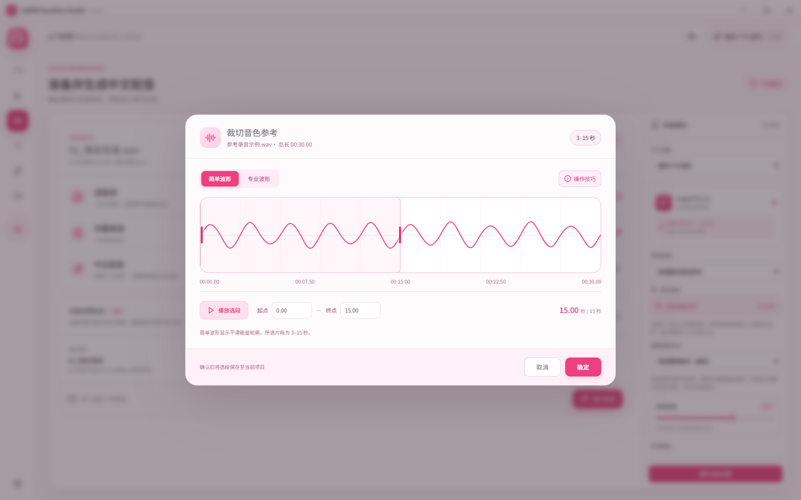</a><p style="font-size: 12px; line-height: 1.5; text-align: center; margin: 4px 0 8px;">参考音频试听裁切</p></td>
  </tr>
  <tr style="border: 0; background: transparent;">
    <td width="50%" align="center" style="border: 0; padding: 0; vertical-align: top;"><a href="assets/tutorial/11-voices.png" style="display: block; position: relative; aspect-ratio: 8 / 5; box-sizing: border-box; border: 1px solid #d0d7de; padding: 6px; overflow: hidden;">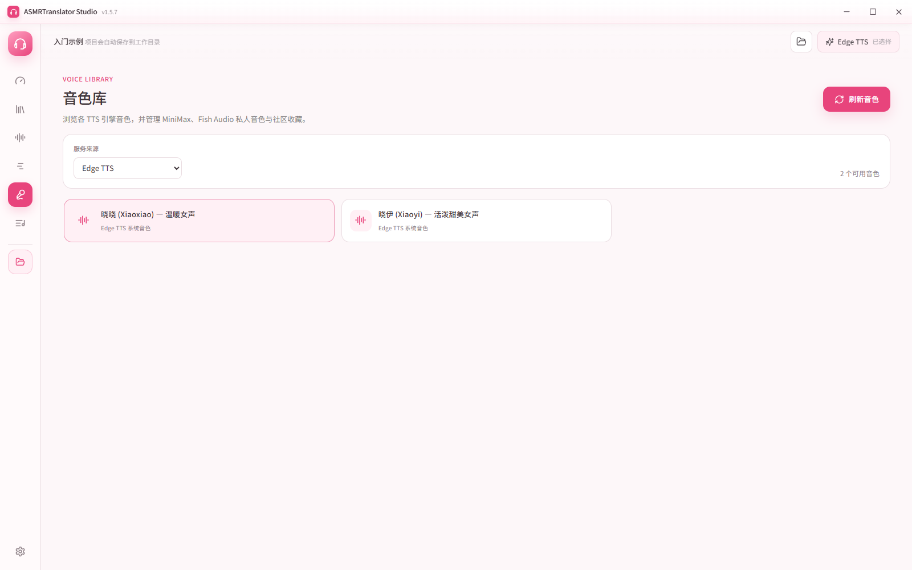</a><p style="font-size: 12px; line-height: 1.5; text-align: center; margin: 4px 0 8px;">音色库</p></td>
    <td width="50%" align="center" style="border: 0; padding: 0; vertical-align: top;"><a href="assets/tutorial/12-tasks.png" style="display: block; position: relative; aspect-ratio: 8 / 5; box-sizing: border-box; border: 1px solid #d0d7de; padding: 6px; overflow: hidden;">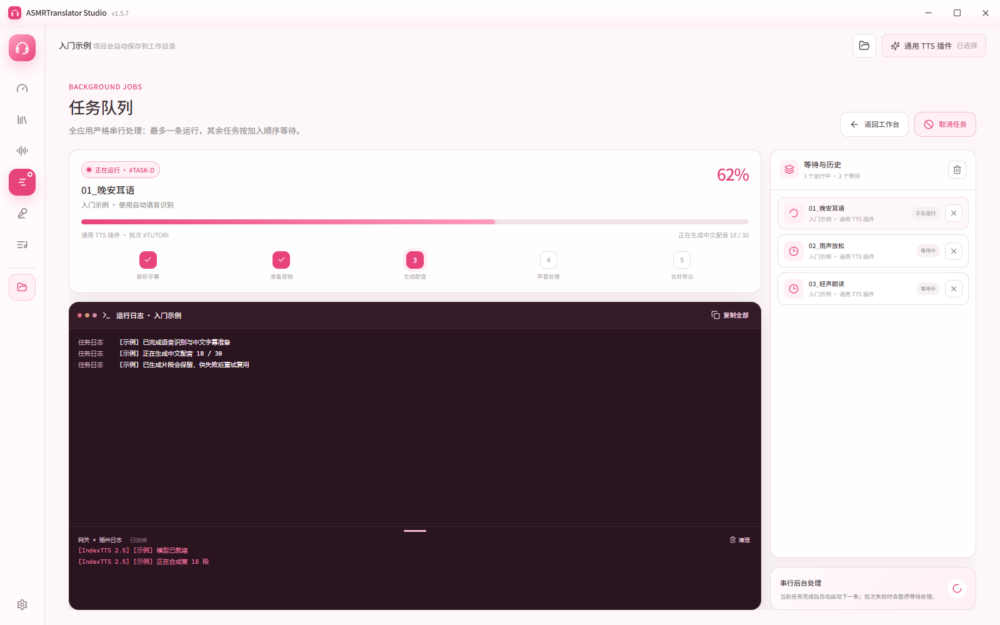</a><p style="font-size: 12px; line-height: 1.5; text-align: center; margin: 4px 0 8px;">任务队列与插件日志</p></td>
  </tr>
  <tr style="border: 0; background: transparent;">
    <td width="50%" align="center" style="border: 0; padding: 0; vertical-align: top;"><a href="assets/tutorial/13-results.png" style="display: block; position: relative; aspect-ratio: 8 / 5; box-sizing: border-box; border: 1px solid #d0d7de; padding: 6px; overflow: hidden;">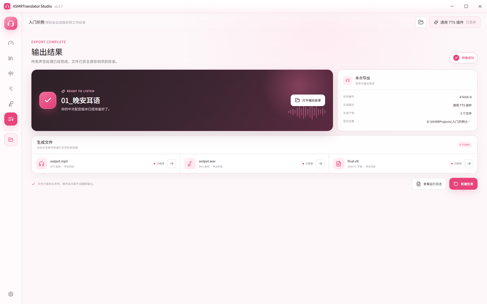</a><p style="font-size: 12px; line-height: 1.5; text-align: center; margin: 4px 0 8px;">输出结果与文件</p></td>
    <td width="50%" align="center" style="border: 0; padding: 0; vertical-align: top;"><a href="assets/tutorial/17-arrangement-dual-timeline.png" style="display: block; position: relative; aspect-ratio: 8 / 5; box-sizing: border-box; border: 1px solid #d0d7de; padding: 6px; overflow: hidden;">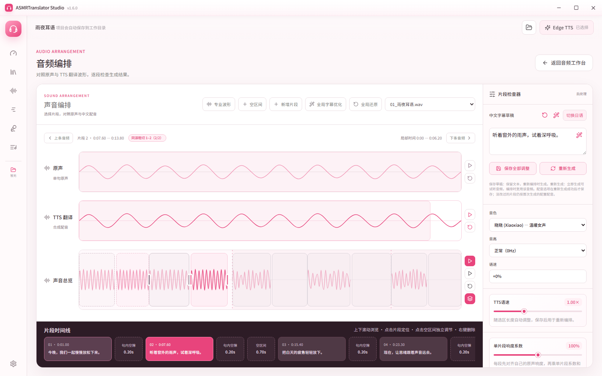</a><p style="font-size: 12px; line-height: 1.5; text-align: center; margin: 4px 0 8px;">音频编排与保留原声双时间轴</p></td>
  </tr>
  <tr style="border: 0; background: transparent;">
    <td width="50%" align="center" style="border: 0; padding: 0; vertical-align: top;"><a href="assets/tutorial/18-arrangement-fragment-tts.png" style="display: block; position: relative; aspect-ratio: 8 / 5; box-sizing: border-box; border: 1px solid #d0d7de; padding: 6px; overflow: hidden;">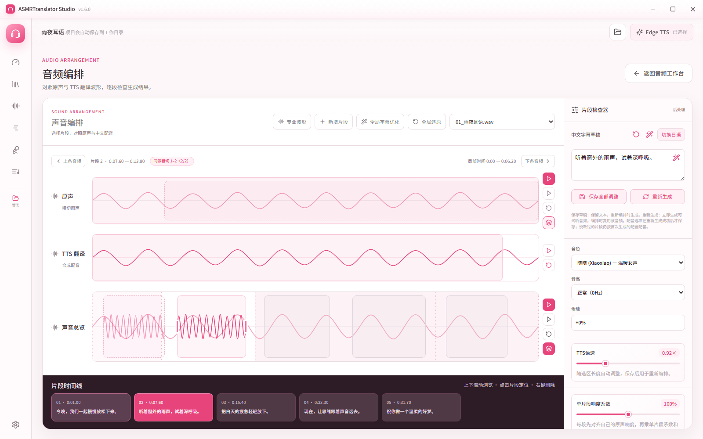</a><p style="font-size: 12px; line-height: 1.5; text-align: center; margin: 4px 0 8px;">逐句配音参数与全局片段视图</p></td>
    <td width="50%" align="center" style="border: 0; padding: 0; vertical-align: top;"><a href="assets/tutorial/19-arrangement-global-optimize.png" style="display: block; position: relative; aspect-ratio: 8 / 5; box-sizing: border-box; border: 1px solid #d0d7de; padding: 6px; overflow: hidden;">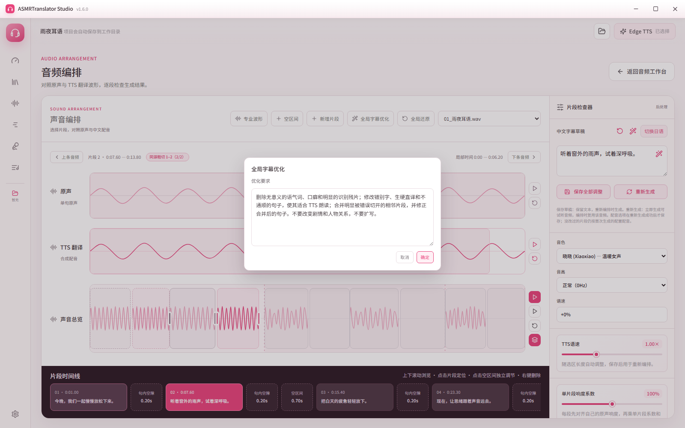</a><p style="font-size: 12px; line-height: 1.5; text-align: center; margin: 4px 0 8px;">指令式全局字幕优化</p></td>
  </tr>
  <tr style="border: 0; background: transparent;">
    <td width="50%" align="center" style="border: 0; padding: 0; vertical-align: top;"><a href="assets/tutorial/14-plugin-catalog.png" style="display: block; position: relative; aspect-ratio: 8 / 5; box-sizing: border-box; border: 1px solid #d0d7de; padding: 6px; overflow: hidden;">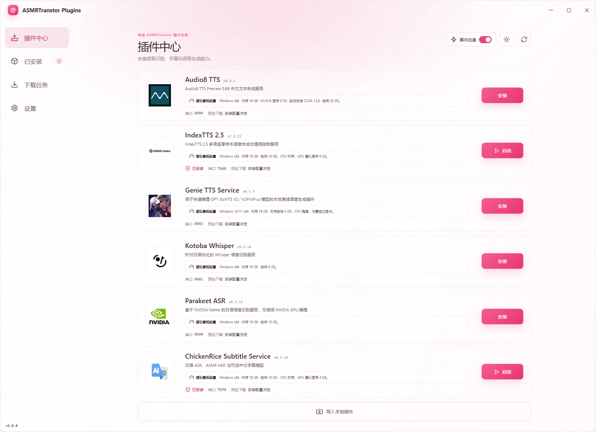</a><p style="font-size: 12px; line-height: 1.5; text-align: center; margin: 4px 0 8px;">六款插件一览</p></td>
    <td width="50%" align="center" style="border: 0; padding: 0; vertical-align: top;"><a href="assets/tutorial/15-plugin-install.png" style="display: block; position: relative; aspect-ratio: 8 / 5; box-sizing: border-box; border: 1px solid #d0d7de; padding: 6px; overflow: hidden;">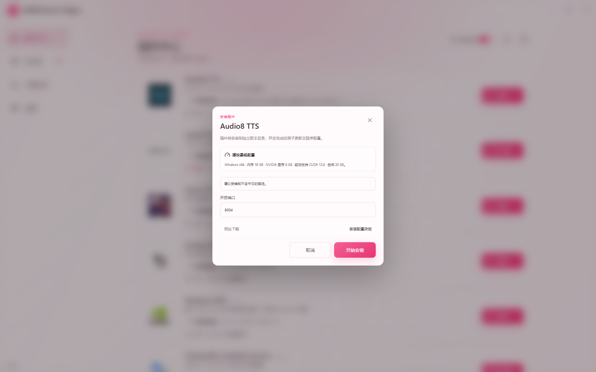</a><p style="font-size: 12px; line-height: 1.5; text-align: center; margin: 4px 0 8px;">插件下载安装</p></td>
  </tr>
  <tr style="border: 0; background: transparent;">
    <td width="50%" align="center" style="border: 0; padding: 0; vertical-align: top;"><a href="assets/tutorial/16-plugin-launch.png" style="display: block; position: relative; aspect-ratio: 8 / 5; box-sizing: border-box; border: 1px solid #d0d7de; padding: 6px; overflow: hidden;">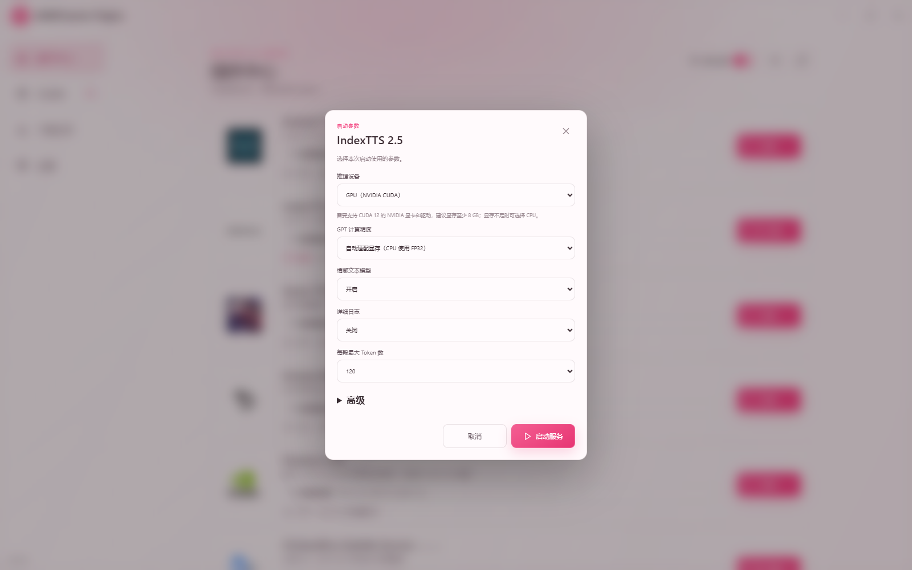</a><p style="font-size: 12px; line-height: 1.5; text-align: center; margin: 4px 0 8px;">插件启动参数</p></td>
    <td width="50%" align="center" style="border: 0; padding: 0; vertical-align: top;"></td>
  </tr>
</table>

---

## TTS 引擎与识别方案

| 引擎 | 主要能力 | 凭证或服务 |
| --- | --- | --- |
| **Edge TTS** | 免费在线音色、语速与音高设置 | 无需 API Key，需要联网 |
| **MiMo TTS** | 标准音色、文字音色设计、参考音频克隆 | 需要 MiMo API Key |
| **Fish Audio** | 免费/高质量模型（含 `drama-3`）、音色库、音色设计与克隆 | 需要 Fish Audio API Key |
| **MiniMax** | 高质量与快速模型、系统及自定义音色 | 需要 MiniMax API Key |
| **通用 TTS 插件** | 目前包含 Audio8 TTS、IndexTTS 2.5、Genie TTS | 通过独立插件仓库安装模型与服务 |

### 字幕与无字幕识别

- 支持导入 **VTT / SRT / LRC** 字幕文件（自动兼容 UTF-8、GBK、Shift-JIS 等常见编码）。
- 有字幕时可直接按时间轴切分并配音，也可启用文字大模型优化字幕。
- 无字幕时可使用 FSMN-VAD / ASMR VAD 配合 **DeepSeek ASR**、**Fish ASR**、**千问 Qwen-Audio / Fun-ASR**、**小米 MiMo ASR（日语实验）**、**MOSS**、通用 ASR 服务（**Kotoba-Whisper**、**Parakeet**）或 **ChickenRice（海南鸡）** 完成识别。
- 如需把日语识别结果自动翻译成中文，可配置 OpenAI 兼容接口或 Anthropic 接口。

---

## 插件与二次开发

后端源码现已公开：[ASMRTranslator Backend](https://github.com/wanasummer/ASMRTranslator-backend)（PolyForm Noncommercial 1.0.0 许可，仅限非商业用途）。

插件统一在独立仓库维护：[ASMRTranslator Plugin](https://gitee.com/SummerXZ/asmrtranslator-plugin)，目前提供：

- **TTS 语音合成**：Audio8 TTS、IndexTTS 2.5、Genie TTS
- **ASR 语音识别**：Kotoba-Whisper、Parakeet
- **字幕服务**：ChickenRice（海南鸡）

第三方服务只要遵守对应接口契约，即可在不修改 ASMRTranslator 主流程的情况下接入。

---

## 系统要求

- Windows 10 / 11，64 位。
- Microsoft Edge WebView2 Runtime（多数 Windows 10/11 设备已预装）。
- 使用在线 TTS、ASR、文字大模型或云端服务时需要联网。
- 本地 IndexTTS、Genie TTS、ChickenRice 或通用 ASR 服务需要按[独立插件仓库](https://gitee.com/SummerXZ/asmrtranslator-plugin)中的文档准备运行环境和模型。
- 请预留足够磁盘空间保存原始音频、项目文件、插件模型及 MP3/WAV 输出。

---

## 常见问题

### 为什么 Fish Audio 使用报错？

请先确认使用的是 Fish Audio 官方站点（[https://fish.audio](https://fish.audio) · [API 文档](https://docs.fish.audio/)），避免误入其他仿冒或第三方站点。随后在设置页测试连接，检查 API Key、账户额度和网络是否能访问 Fish Audio 服务。若启用了代理，请检查其配置；界面的具体错误信息可帮助区分网络、凭据和服务限流问题。

### 没有字幕可以使用吗？

可以。可选择 Fish ASR、千问 Qwen-Audio / Fun-ASR、小米 MiMo ASR（日语实验）、MOSS、兼容 CommonASR 契约的服务或 ChickenRice；如需将日语识别结果自动翻译成中文，还要配置文字大模型接口并开启自动翻译。

### 输出文件在哪里？

转换成功后可在结果页直接预览字幕并打开产物文件；每段音频的生成产物位于项目 `generated/` 目录下，也可通过一键导出集中整理最终 MP3 与字幕。

### 同一项目能处理多个音频吗？

可以。在首页或项目页选择文件夹即可自动扫描并导入全部音频，在项目音频资产列表中选择要处理的文件，并通过任务队列与批次控制执行。

### IndexTTS 应该怎样连接？

在设置页选择“通用 TTS 插件（自动识别）”，在已安装插件中选择 IndexTTS 2.5，本机模式会自动读取端口；服务器模式填写服务地址后点击“重新识别插件”。检测并启用后，在工作台设置音色与情感参考。

### 为什么 Windows 提示未知发布者？

当前安装包尚未签名。请从本仓库下载，并核对上方 SHA-256。后续获得代码签名证书后会改善这一提示。

---

## 版本历史

| 版本 | 日期 | 说明 |
| --- | --- | --- |
| **v1.6.1** | 2026-11-22 | 新增 DeepSeek ASR 语音识别引擎；Fish Audio 新增 `drama-3` 高表现力模型及费率标识；修复设置页服务连接模式持久化问题 |
| **v1.6.0** | 2026-11-21 | 新增音频编排工作台与双保留原声时间轴编辑、逐句独立配音参数、指令式全局字幕优化、MOSS/ASR Boost/ASMR VAD 识别与对齐、UVR 人声分离、直接打开音频/文件夹为项目、高音质导出与封面嵌入；项目数据统一管理并修复编码导入、试听与导出时间轴等问题 |
| **v1.5.7** | 2026-10-18 | 新增通用 TTS 插件识别与参数配置、参考音频试听裁切、逐段结果缓存、插件实时日志和任务异常诊断；修复 Edge TTS 合成、本机 ASR 插件扫描及短音频合并问题 |
| **v1.5.6** | 2026-10-10 | 新增自动检查更新与一键下载安装；显示更新进度并等待任务完成后安装；改善 DeepSeek 字幕处理；修复错误日志上报 |
| **v1.5.5** | 2026-10-05 | 默认仅生成字幕；任务预检与仅加入队列；最近任务记录与首页布局优化；保留音频标签和封面；后端直连优先与自动代理回退；改善 LLM、ASR 和 Fish Audio 稳定性 |
| **v1.5.4** | 2026-09-25 | 新增千问和 MiMo 云端 ASR、任务服务预检查、TTS 检测启用、本机插件扫描与连接模式、Fish 社区音色管理、资源并发设置、缓存恢复与清理，以及追加导入音频 |
| **v1.5.3** | 2026-09-20 | 文件夹导入、多音频批处理与批次控制；项目一键导出；VAD/ASR/日语时间轴增强；结构化错误与开发者诊断；插件迁移至独立仓库；修复 1.5.2 的 VAD、ASR、IndexTTS、布局及错误处理问题 |
| **v1.5.2** | 2026-09-02 | 紧急回滚重发：修复 MeCab 运行依赖缺失及 GPT-5.x 模型兼容性问题；项目多音频与独立产物目录；新增 Genie TTS、CommonASR、Kotoba-Whisper、Parakeet 与 ChickenRice |
| **v1.5.1** | 2026-08-25 | 修复了一些严重 Bug |
| **v1.5.0** | 2026-08-25 | 首个 Tauri 2 + Svelte 5 桌面版本：项目、任务与音色工作台，全新 UI，Nuitka 后端，ASR/LLM/音频流程增强 |
| v1.4.6 | 2026-08-22 | Electron 版：新增 IndexTTS 2.5 本地与云端服务接口 |
| v1.4.5 | 2026-08-16 | Electron 版：新增 MiniMax TTS、无字幕 ASR 模式与潜意识同传增强 |

---

## 交流群


*感谢使用 ASMRTranslator。祝你拥有舒适的中文 ASMR 体验。*

如需反馈问题或建议，请在本仓库 [Issues](../../issues) 中提出。
