# ASMRTranslator Studio

ASMRTranslator Studio 是一款面向日文 ASMR 的 Windows 桌面工具，可自动识别语音、翻译并生成中文字幕，也能制作中文配音，替换原声、在原声之间插入翻译或与原声同步叠加，支持批量处理和导出。

使用时，先创建项目并导入音频，已有字幕可一并导入；配置识别和翻译服务后即可生成字幕。需要中文配音时，再选择 TTS 服务或插件、音色及听感模式，启动任务并导出结果。

插件安装器及插件下载请前往：[ASMRTranslator Plugin 仓库](https://gitee.com/SummerXZ/asmrtranslator-plugin)。

**[图文使用教程](使用教程.md)**：从安装配置到字幕生成、中文配音和批量导出。

界面展示（使用示例项目，每行两张，点击图片查看原图）· [查看完整总览](assets/tutorial/overview-4x4.jpg)

<table style="border-collapse: separate; border-spacing: 4px;">
  <tr>
    <td width="50%" align="center"><a href="assets/tutorial/01-home.png">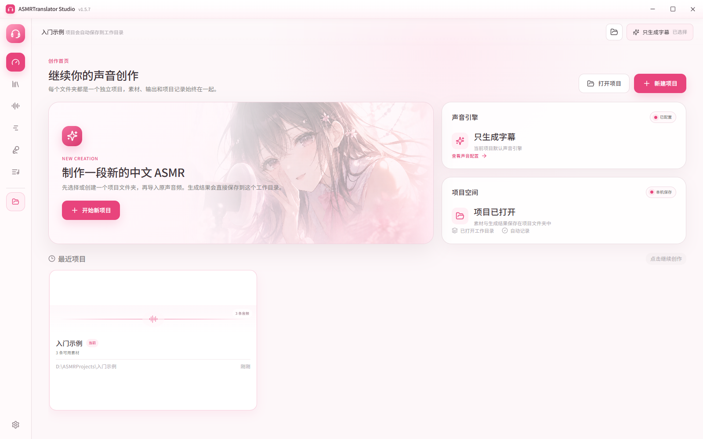</a><br />首页与项目入口</td>
    <td width="50%" align="center"><a href="assets/tutorial/02-project.png">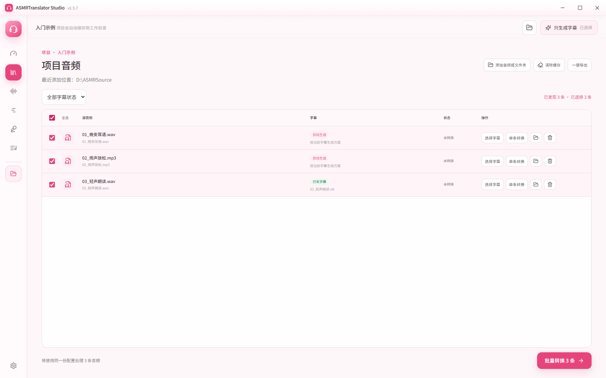</a><br />素材导入与批量选择</td>
  </tr>
  <tr>
    <td width="50%" align="center"><a href="assets/tutorial/03-settings-llm.png">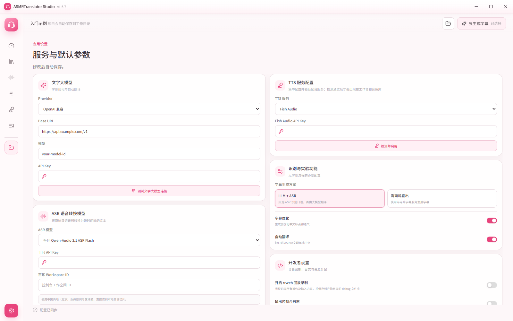</a><br />文字大模型与在线识别</td>
    <td width="50%" align="center"><a href="assets/tutorial/04-settings-asr.png">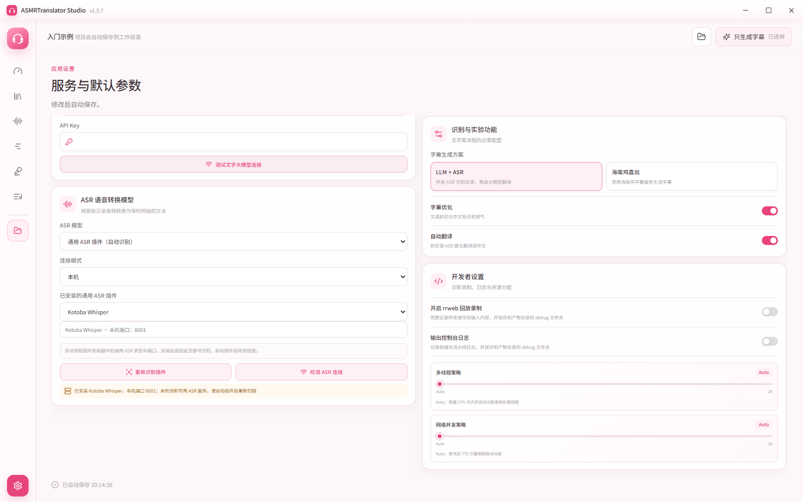</a><br />通用 ASR 插件</td>
  </tr>
  <tr>
    <td width="50%" align="center"><a href="assets/tutorial/05-settings-chickenrice.png">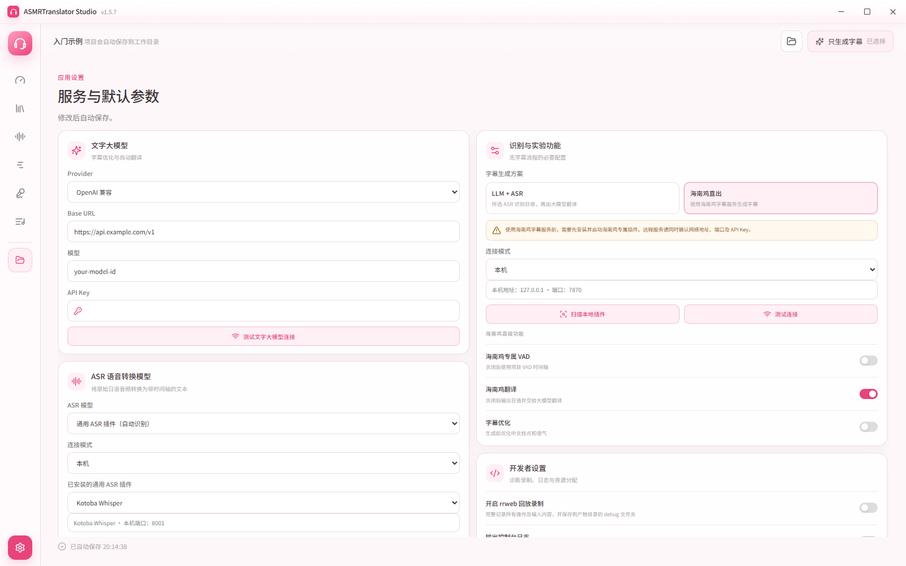</a><br />海南鸡字幕方案</td>
    <td width="50%" align="center"><a href="assets/tutorial/06-settings-common-tts.png">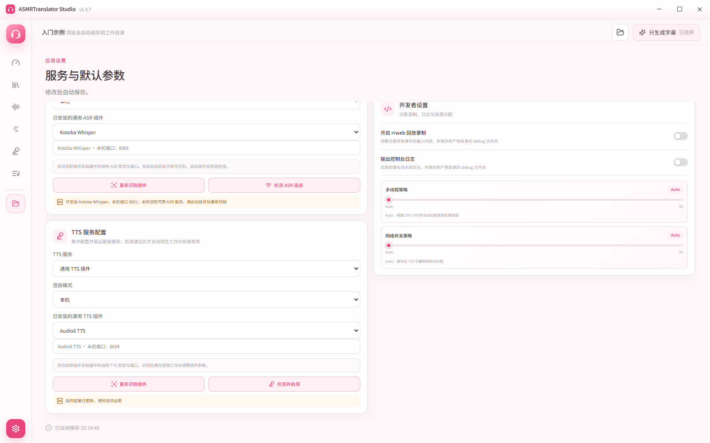</a><br />通用 TTS 插件</td>
  </tr>
  <tr>
    <td width="50%" align="center"><a href="assets/tutorial/07-studio-subtitles.png">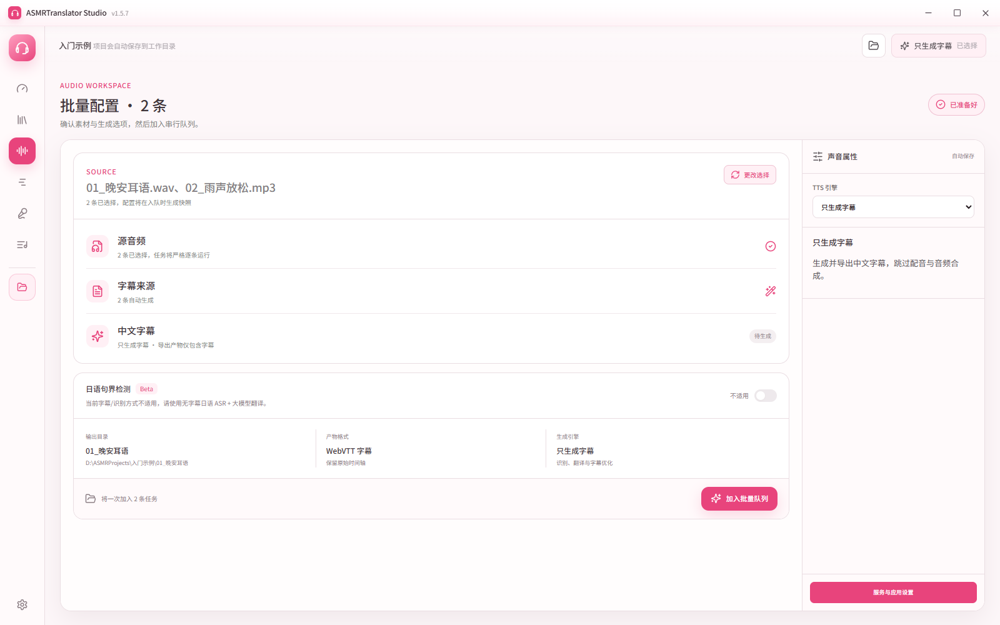</a><br />只生成中文字幕</td>
    <td width="50%" align="center"><a href="assets/tutorial/08-studio-edge.png">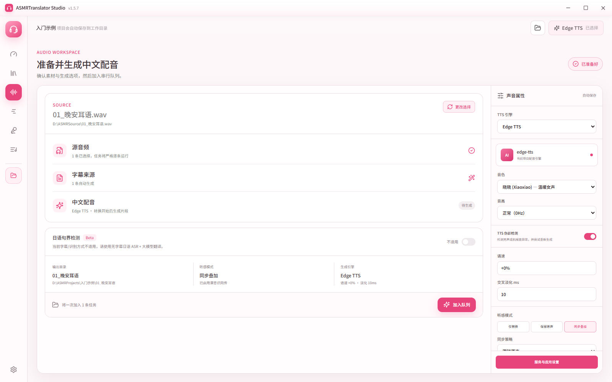</a><br />中文配音与听感</td>
  </tr>
  <tr>
    <td width="50%" align="center"><a href="assets/tutorial/09-studio-indextts.png">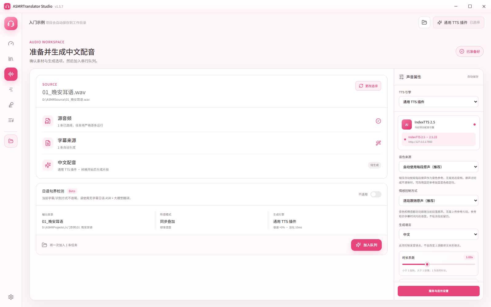</a><br />音色与情感参考</td>
    <td width="50%" align="center"><a href="assets/tutorial/10-reference-audio.png">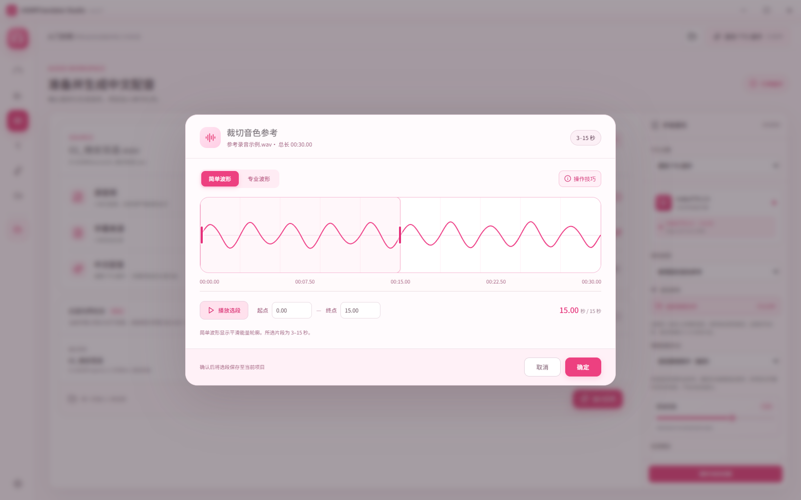</a><br />参考音频试听裁切</td>
  </tr>
  <tr>
    <td width="50%" align="center"><a href="assets/tutorial/11-voices.png">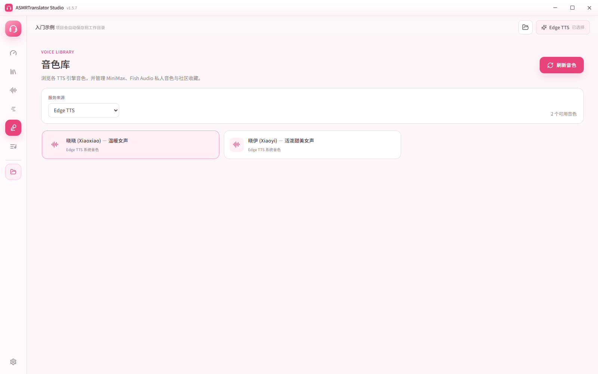</a><br />音色库</td>
    <td width="50%" align="center"><a href="assets/tutorial/12-tasks.png">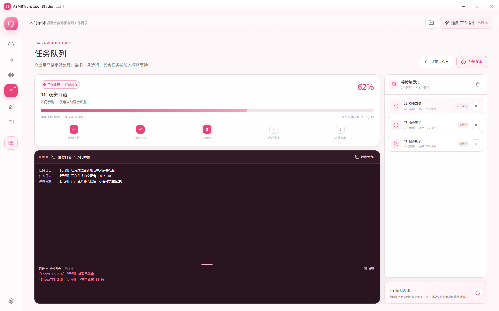</a><br />任务队列与插件日志</td>
  </tr>
  <tr>
    <td width="50%" align="center"><a href="assets/tutorial/13-results.png">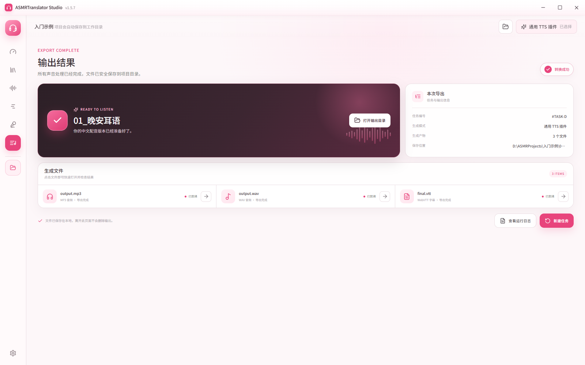</a><br />输出结果与文件</td>
    <td width="50%" align="center"><a href="assets/tutorial/14-plugin-catalog.png">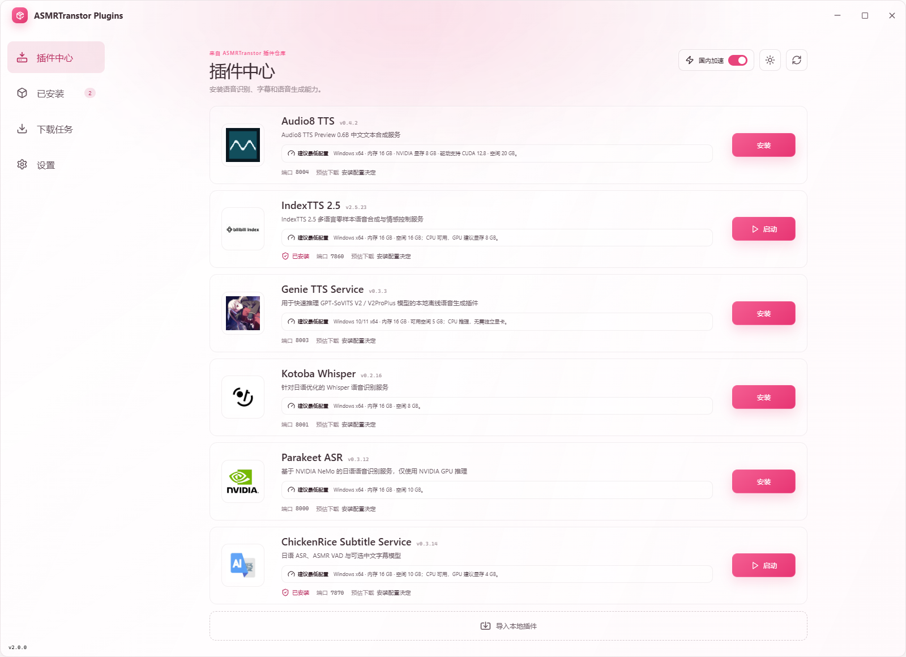</a><br />六款插件一览</td>
  </tr>
  <tr>
    <td width="50%" align="center"><a href="assets/tutorial/15-plugin-install.png">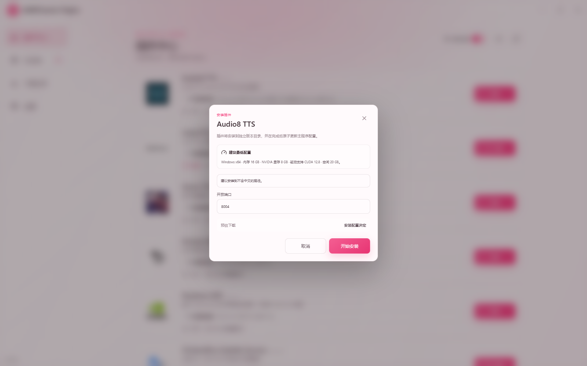</a><br />插件下载安装</td>
    <td width="50%" align="center"><a href="assets/tutorial/16-plugin-launch.png">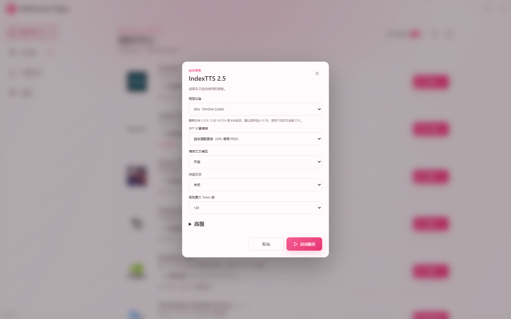</a><br />插件启动参数</td>
  </tr>
</table>

---

## 下载最新版

| 版本 | 安装包 | 大小 | 发布日期 | 下载 |
| --- | --- | --- | --- | --- |
| **v1.5.7** | `ASMRTranslator.Studio_1.5.7_x64-setup.exe` | 约 125.82 MiB | 2026-10-18（北京时间） | [下载安装包](https://github.com/wanasummer/ASMRTranslator-bin/releases/download/v1.5.7/ASMRTranslator.Studio_1.5.7_x64-setup.exe) |

[查看 v1.5.7 发布页](https://github.com/wanasummer/ASMRTranslator-bin/releases/tag/v1.5.7) · [下载校验文件](https://github.com/wanasummer/ASMRTranslator-bin/releases/download/v1.5.7/ASMRTranslator.Studio_1.5.7_x64-setup.exe.sha256)

SHA-256：

```text
484E3A58D45F44692188566133647BC0FBDE38525629CE9143E2B250081BF9FE
```

> 当前安装包尚未进行代码签名。Windows SmartScreen 可能显示“未知发布者”，请核对文件名和 SHA-256 后再运行。

---

## v1.5.7 发布说明

### 新功能与体验改进

- 新增通用 TTS 插件接入，自动识别已安装的插件、端口与参数，支持 Audio8、IndexTTS 和 Genie 等插件及服务器连接。
- 工作台按所选插件展示音色参考、情感控制与高级合成参数，并随项目保存；支持使用逐段原声作为音色和情感参考。
- 新增参考音频波形编辑器，支持缩放、试听和裁切选段，选段保存在当前项目中。
- 识别、翻译和配音支持逐段保存结果；部分片段失败后继续处理其余片段，重试时复用已成功的结果。
- 任务中心新增插件实时日志，支持调整日志区域大小、查看连接状态和复制本次运行的完整记录；清空显示后仍可复制此前记录。
- 新增任务异常诊断，任务异常失败时自动上报任务与插件日志。

### 修复与稳定性改进

- 修复 Edge TTS 无法正常合成语音的问题，并改善访问被拒绝时的错误提示。
- 修复本机 ASR 扫描可能选中未就绪服务或错误端口的问题，优先选择已正常运行的插件。
- 修复极短音频片段导致最终音频合并中断的问题。

---

## 主要功能

- **仅生成字幕**：默认生成字幕，无需配置 TTS；需要中文配音时再选择对应引擎。
- **项目化工作流**：创建或打开项目，通过文件或文件夹导入维护项目音频资产，并分别管理字幕、配音配置和每段音频的输出结果。
- **批量任务中心**：查看阶段、总进度、实时日志和最终输出，支持任务队列、取消任务、批次启动与批次控制。
- **项目一键导出**：批量导出最终 MP3 与 WebVTT 字幕，并维护导出清单。
- **TTS 引擎**：Edge TTS、MiMo TTS、Fish Audio、MiniMax 与通用 TTS 插件（Audio8 TTS、IndexTTS 2.5、Genie TTS）。
- **音色工作台**：浏览和管理音色；支持 Fish 社区音色、服务商音色设计、参考音频克隆及本地音色导入。
- **可扩展 ASR**：支持 Fish ASR、千问 Qwen-Audio / Fun-ASR、小米 MiMo ASR（日语实验）、Kotoba-Whisper、Parakeet 等通用 ASR 服务和 ChickenRice（海南鸡）字幕服务。
- **服务检测与插件扫描**：任务启动前检查所需服务；本机插件可自动读取安装器配置并回填端口。
- **缓存恢复与清理**：重试时复用已完成阶段，按音频清理中间缓存。
- **无字幕处理**：使用本地 FSMN-VAD 检测语音区间，再进行识别、翻译和字幕优化。
- **音频流程增强**：改进任务资源管理、重叠片段处理、LLM 响应解析和 TTS 伪影检测。

---

## 基本使用流程

1. 安装并启动 ASMRTranslator Studio。
2. 新建或打开项目，选择单个音频或导入包含多段音频的文件夹。
3. 按需选择 VTT、SRT 或 LRC 字幕；不提供字幕时可启用无字幕识别流程。
4. 在设置页配置所需服务并检测连接。默认仅生成字幕；如需中文配音，再选择 TTS 引擎、音色、听感模式和声音参数。
5. 将所需音频加入任务队列，按需启动单项任务或整个批次，并在任务中心查看进度与日志。
6. 完成后从结果页打开产物，或使用项目一键导出批量整理最终 MP3 与 WebVTT 字幕。

每段音频的产物保存在项目目录下以音频文件名命名的子目录中。配置会自动保存到用户目录下的 `.asmrts` 文件。

---

## TTS 引擎

| 引擎 | 主要能力 | 凭证或服务 |
| --- | --- | --- |
| **Edge TTS** | 免费在线音色、语速与音高设置 | 无需 API Key，需要联网 |
| **MiMo TTS** | 标准音色、文字音色设计、参考音频克隆 | 需要 MiMo API Key |
| **Fish Audio** | 免费/高质量模型、音色库、音色设计与克隆 | 需要 Fish Audio API Key |
| **MiniMax** | 高质量与快速模型、系统及自定义音色 | 需要 MiniMax API Key |
| **通用 TTS 插件** | 目前包含 Audio8 TTS、IndexTTS 2.5、Genie TTS | 通过独立插件仓库安装模型与服务 |

插件仓库还提供 ChickenRice（海南鸡）字幕服务，以及 Kotoba-Whisper、Parakeet 两款 ASR 插件。

在线接口的可用模型、额度和计费以各服务商规则为准。

---

## 字幕与无字幕模式

- 支持 VTT、SRT、LRC 字幕文件。
- 有字幕时可直接按时间轴切分并配音，也可启用文字大模型优化字幕。
- 无字幕时可使用 FSMN-VAD 配合 Fish ASR、千问 Qwen-Audio / Fun-ASR、小米 MiMo ASR（日语实验）、通用 ASR 服务或 ChickenRice 完成识别。
- 千问 Qwen-Audio 3.1 ASR Flash 需要千问 API Key 和百炼 Workspace ID；Fun-ASR 使用千问 API Key。
- MiMo ASR 使用独立的 MiMo ASR API Key 配置，日语识别采用 auto 模式，属于实验功能。
- 通用 ASR 的本机模式从插件安装器读取端口；服务器模式可配置地址、端口和可选 Bearer API Key。
- 如需把 ASR 原文翻译成中文，需要配置 OpenAI 兼容接口或 Anthropic 接口。

---

## 插件与二次开发

插件已从本发布仓库移除，现统一在独立仓库维护：

- [ASMRTranslator Plugin](https://gitee.com/SummerXZ/asmrtranslator-plugin)

目前提供以下 6 款插件：

- **TTS 语音合成**：Audio8 TTS、IndexTTS 2.5、Genie TTS。
- **ASR 语音识别**：Kotoba-Whisper、Parakeet。
- **字幕服务**：ChickenRice（海南鸡）。

插件的安装文件、部署说明与开发接口文档，请前往插件仓库获取。第三方服务只要遵守对应接口契约，即可在不修改 ASMRTranslator 主流程的情况下接入。

---

## 听感模式

- **仅替换**：用中文配音替换对应的原声片段。
- **保留原声**：保留原声并插入中文翻译音频。
- **同步叠加**：中文配音与原声同步播放，可选择跟随原声或跟随翻译。
- **潜意识同传**：在同步叠加基础上加入延迟、混响、齿音柔化、原声/尾声淡化等处理。

还可调整语速、翻译音量、交叉淡化、最大加速倍率，并启用 TTS 伪影检测。

---

## 系统要求

- Windows 10 / 11，64 位。
- Microsoft Edge WebView2 Runtime。多数 Windows 10/11 设备已预装。
- 使用在线 TTS、ASR、文字大模型或云端 IndexTTS 时需要联网。
- 本地 IndexTTS、Genie TTS、ChickenRice 或通用 ASR 服务需要按[独立插件仓库](https://gitee.com/SummerXZ/asmrtranslator-plugin)中的文档准备运行环境和模型。
- 请预留足够空间保存原始音频、项目文件、插件模型及 MP3/WAV 输出。

---

## 常见问题

### 为什么 Fish Audio 使用报错？

先在设置页测试连接，检查 API Key、账户额度和网络是否能访问 Fish Audio 服务。若启用了代理，请检查其配置；界面的具体错误信息可帮助区分网络、凭据和服务限流问题。

### 没有字幕可以使用吗？

可以。可选择 Fish ASR、千问 Qwen-Audio / Fun-ASR、小米 MiMo ASR（日语实验）、兼容 CommonASR 契约的服务或 ChickenRice；如需将日语识别结果自动翻译成中文，还要配置文字大模型接口并开启自动翻译。

### 输出文件在哪里？

转换成功后可在结果页直接打开 MP3、WAV、字幕和日志。每段音频的全部产物都位于项目目录下同名的音频子目录中。

### 同一项目能处理多个音频吗？

可以。可以一次导入文件夹，在项目音频资产列表中选择要处理的文件，并通过任务队列与批次控制执行。不同文件名会保留各自的任务记录和产物目录。

### 怎样批量导出结果？

使用项目一键导出，可集中导出已完成任务的最终 MP3 和 WebVTT 字幕，并生成导出清单。

### IndexTTS 应该怎样连接？

在设置页选择“通用 TTS 插件（自动识别）”，在已安装插件中选择 IndexTTS 2.5，本机模式会自动读取端口；服务器模式填写服务地址后点击“重新识别插件”。检测并启用后，在工作台设置音色与情感参考。

### 为什么 Windows 提示未知发布者？

当前安装包尚未签名。请从本仓库下载，并核对上方 SHA-256。后续获得代码签名证书后会改善这一提示。

---

## 版本历史

| 版本 | 日期 | 说明 |
| --- | --- | --- |
| **v1.5.7** | 2026-10-18 | 新增通用 TTS 插件识别与参数配置、参考音频试听裁切、逐段结果缓存、插件实时日志和任务异常诊断；修复 Edge TTS 合成、本机 ASR 插件扫描及短音频合并问题 |
| **v1.5.6** | 2026-10-10 | 新增自动检查更新与一键下载安装；显示更新进度并等待任务完成后安装；改善 DeepSeek 字幕处理；修复错误日志上报 |
| **v1.5.5** | 2026-10-05 | 默认仅生成字幕；任务预检与仅加入队列；最近任务记录与首页布局优化；保留音频标签和封面；后端直连优先与自动代理回退；改善 LLM、ASR 和 Fish Audio 稳定性 |
| **v1.5.4** | 2026-09-25 | 新增千问和 MiMo 云端 ASR、任务服务预检查、TTS 检测启用、本机插件扫描与连接模式、Fish 社区音色管理、资源并发设置、缓存恢复与清理，以及追加导入音频 |
| **v1.5.3** | 2026-09-20 | 文件夹导入、多音频批处理与批次控制；项目一键导出；VAD/ASR/日语时间轴增强；结构化错误与开发者诊断；插件迁移至独立仓库；修复 1.5.2 的 VAD、ASR、IndexTTS、布局及错误处理问题 |
| **v1.5.2** | 2026-09-02 | 紧急回滚重发：修复 MeCab 运行依赖缺失及 GPT-5.x 模型兼容性问题；项目多音频与独立产物目录；新增 Genie TTS、CommonASR、Kotoba-Whisper、Parakeet 与 ChickenRice |
| **v1.5.1** | 2026-08-25 | 修复了一些严重 Bug |
| **v1.5.0** | 2026-08-25 | 首个 Tauri 2 + Svelte 5 桌面版本：项目、任务与音色工作台，全新 UI，Nuitka 后端，ASR/LLM/音频流程增强 |
| v1.4.6 | 2026-08-22 | Electron 版：新增 IndexTTS 2.5 本地与云端服务接口 |
| v1.4.5 | 2026-08-16 | Electron 版：新增 MiniMax TTS、无字幕 ASR 模式与潜意识同传增强 |

---

## 交流群


*感谢使用 ASMRTranslator。祝你拥有舒适的中文 ASMR 体验。*

如需反馈问题或建议，请在本仓库 [Issues](../../issues) 中提出。
