# ASMRTranslator Studio 使用教程

本教程介绍如何把日文 ASMR 制作成中文字幕或中文配音，按主程序 **v1.6.1** 与当前插件安装器界面编写。已有中文字幕的音频可以直接进入配音流程，也可以一次导入多段音频批量处理。

文中截图来自当前项目的界面组件预览，使用示例项目、示例路径、示例波形与任务状态说明操作；不代表真实模型已经完成推理。截图中的 `api.example.com` 和 `your-model-id` 是占位内容，使用时请换成服务商提供的地址和模型名称。

[返回项目首页](README.md) · [下载主程序](https://github.com/wanasummer/ASMRTranslator-bin/releases/latest) · [插件安装器与插件](https://gitee.com/SummerXZ/asmrtranslator-plugin)

## 目录

- [先看最短使用流程](#quickstart)
- [准备软件与服务](#prepare)
- [安装和启动本地插件](#plugins)
- [创建项目与导入素材](#project)
- [配置识别与翻译](#subtitles)
- [选择配音引擎与音色](#tts)
- [试听和裁切参考音频](#reference)
- [选择听感模式](#listening)
- [音频编排工作台](#arrangement)
- [提交任务与查看日志](#queue)
- [查看结果与批量导出](#export)
- [常见问题与处理方法](#troubleshooting)
- [操作技巧与服务入口](#tips)

## 先看最短使用流程

第一次使用，可以先选一段较短的音频，完成下面的流程，再处理长音频或整个文件夹。

1. 在“设置”中准备字幕生成方案：**LLM + ASR**，或 **海南鸡直出**。
2. 在首页点击“选择音频或文件夹”或“开始新项目”，直接打开音频，也可以把当前文件夹作为项目；已有项目从最近项目继续打开。
3. 需要增加素材时，在“项目”页点击“添加音频或文件夹”，勾选要处理的音频，点击“单条转换”或“批量转换”。
4. 在“音频工作台”保留默认的“只生成字幕”，即可先生成中文字幕；需要配音时再选择 TTS 引擎和听感模式。
5. 点击“加入队列”，在“任务队列”中查看进度和日志。
6. 完成后进入“输出结果”试听、打开“音频编排”调整片段，最后在结果页或项目页点击“一键导出”。

**只有识别和翻译需求时，不必配置 TTS。** 已有可用的中文字幕时，可以直接绑定字幕并制作配音，不必重新识别音频。

## 准备软件与服务

安装主程序需要 Windows 10 / 11 64 位和 Microsoft Edge WebView2 Runtime。主程序、插件安装器和模型是不同的内容：主程序负责项目、任务与音频处理；安装器负责下载、安装和启动本地插件；在线服务由对应平台提供。

### 先分清三个名称

| 名称 | 负责什么 | 在哪里配置 |
| --- | --- | --- |
| ASR 语音识别 | 把日语音频识别成带时间轴的文字 | 设置 → ASR 语音转换模型 |
| LLM 文字大模型 | 把识别文本翻译成中文，并按需优化字幕 | 设置 → 文字大模型、识别与实验功能 |
| TTS 语音合成 | 把中文字幕生成中文配音 | 设置中检测启用，音频工作台中选引擎和参数 |

### 根据目标准备服务

| 你想做什么 | 需要准备 |
| --- | --- |
| 无字幕音频 → 中文字幕 | ASR + 文字大模型，或能直接输出中文的海南鸡服务 |
| 已有中文字幕 → 中文配音 | 一种 TTS；需要润色时再启用文字大模型 |
| 无字幕音频 → 中文配音 | 字幕生成方案 + 一种 TTS |

在线服务需要各自平台的 API Key、可用额度与网络连接。**购买了文字大模型服务，不等于同时获得 ASR 或 TTS 额度。** Edge TTS 无需 API Key，需要联网；其他服务是否收费、支持哪些模型，以对应平台为准。

本地插件按需安装即可，不必安装全部六款。使用在线识别和在线配音时，可以跳过下一节的本地插件安装。

## 安装和启动本地插件

### 目前有哪些插件

| 类别 | 插件 | 用途 | 默认端口 | 运行条件要点 |
| --- | --- | --- | --- | --- |
| TTS | Audio8 TTS | 使用参考录音与对应文字克隆音色，生成中文语音 | `8004` | 需要 NVIDIA GPU；安装配置建议显存 8 GB、空间 20 GB，驱动支持 CUDA 12.8 |
| TTS | IndexTTS 2.5 | 逐段原声音色与情感参考，也可指定固定音色 | `7860` | 可选 CPU / NVIDIA GPU；GPU 建议显存 8 GB |
| TTS | Genie TTS | 使用已训练的 GPT-SoVITS V2 / V2Pro / V2ProPlus 模型生成语音 | `8003` | CPU 推理；需自行准备配套模型权重 |
| ASR | Kotoba-Whisper | 日语识别，结果可交给文字大模型翻译 | `8001` | 需要 NVIDIA GPU 和支持 CUDA 12.8 的驱动 |
| ASR | Parakeet | 日语识别，结果可交给文字大模型翻译 | `8000` | 需要 NVIDIA GPU 和支持 CUDA 12.8 的驱动 |
| 字幕服务 | ChickenRice（海南鸡） | 日语识别、ASMR VAD 和可选中文字幕直出 | `7870` | 可选 CPU / NVIDIA GPU；GPU 建议显存 4 GB |

端口以安装器当前显示为准。端口被占用时可能自动调整，回到主程序后需要重新识别插件并检测连接。模型与运行库会占用额外空间，完整要求请看安装与启动弹窗。

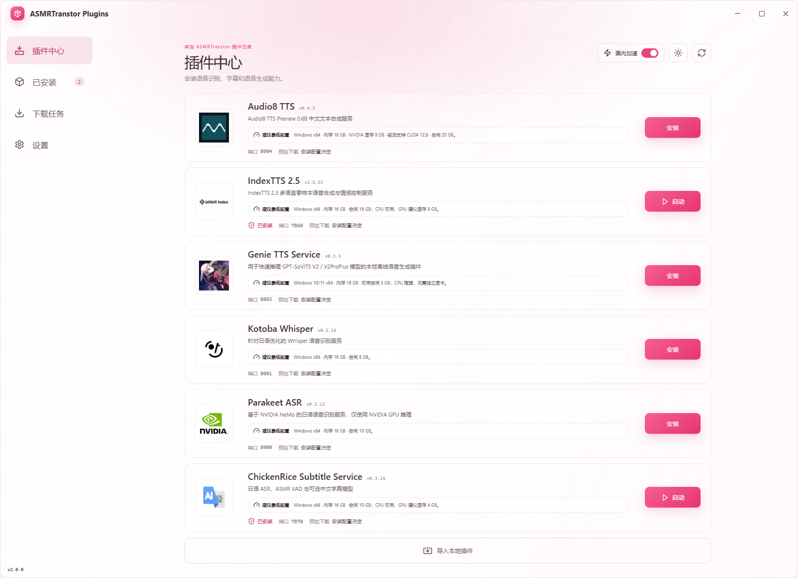

*插件中心：按实际需要选择识别、字幕或配音插件。*

### 下载与安装

1. 从[插件仓库](https://gitee.com/SummerXZ/asmrtranslator-plugin)获取安装器并启动。
2. 在安装器“设置”中选择插件安装目录，例如 `D:\ASMRPlugins`。使用不含中文的路径，可以减少部分依赖的兼容问题。
3. 按网络情况选择是否开启“国内加速”。该选项用于插件与依赖下载，不会代替主程序连接在线 API 所需的网络设置。
4. 在“插件中心”找到需要的插件，点击“安装”。核对配置要求与端口，再点击“开始安装”。
5. 在“下载任务”中等待模型下载、依赖安装与验证完成。安装仍在进行时，不要把“下载完成”当成“插件已就绪”。

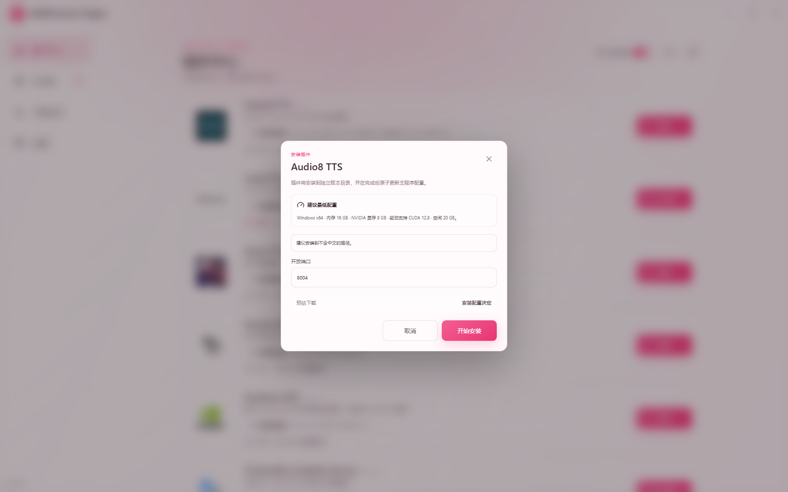

*安装确认窗口：先检查硬件与路径要求，再开始安装。*

### 启动插件

1. 安装完成后，点击插件卡片上的“启动”。
2. 如果弹出“启动参数”，选择本次使用的设备和精度。
3. IndexTTS 使用情感文字描述时，需要开启“情感文本模型”；CPU 模式和 GPU 模式的可用精度不同，按界面提供的选项选择。
4. 点击“启动服务”，等待模型完成加载，再回到主程序检测连接。

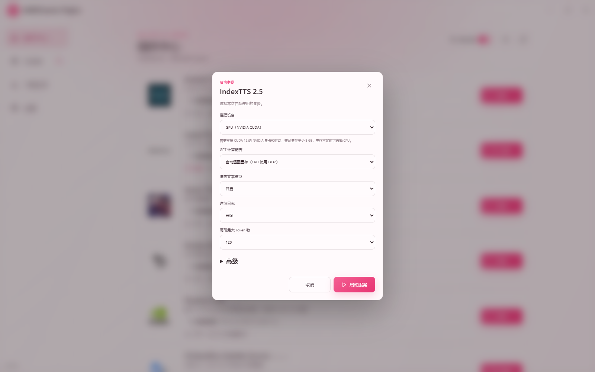

*设备、计算精度等在安装器里设置；音色、情感、参考音频等合成参数在主程序工作台中设置。*

修改设备或精度后，需要停止并重新启动插件。安装器 2.0 使用新的运行环境管理方式，从旧版升级时需重新安装插件，不会自动迁移旧环境。

### 本机与服务器有什么区别

- **本机**：插件和主程序在同一台电脑上。优先使用自动识别，主程序读取安装器记录的插件类型和端口。
- **服务器**：服务运行在另一台电脑或云端。填写服务所在机器的实际 IP / 域名和端口；按需放行对应服务端口，若服务启用了鉴权，还要填写匹配的 API Key。

连接远程服务时，不要把 `127.0.0.1` 当成服务器地址。Genie 的模型权重路径必须能被服务所在机器访问，不能直接使用另一台电脑上的本地文件路径。

## 创建项目与导入素材

### 创建或打开项目

在首页点击“选择音频或文件夹”或“开始新项目”：选择单个音频可直接建立项目，选择“当前文件夹”会以该文件夹为项目并递归扫描音频、匹配同目录字幕。项目页没有打开项目时，也能从“选择音频或文件夹”进入。已有项目从“最近项目”继续打开。项目的生成结果保存在 `generated/`，字幕、编排草稿、缓存记录和运行记录集中存入 `generated/project.sqlite3`；实际音频文件仍位于 `generated/`。

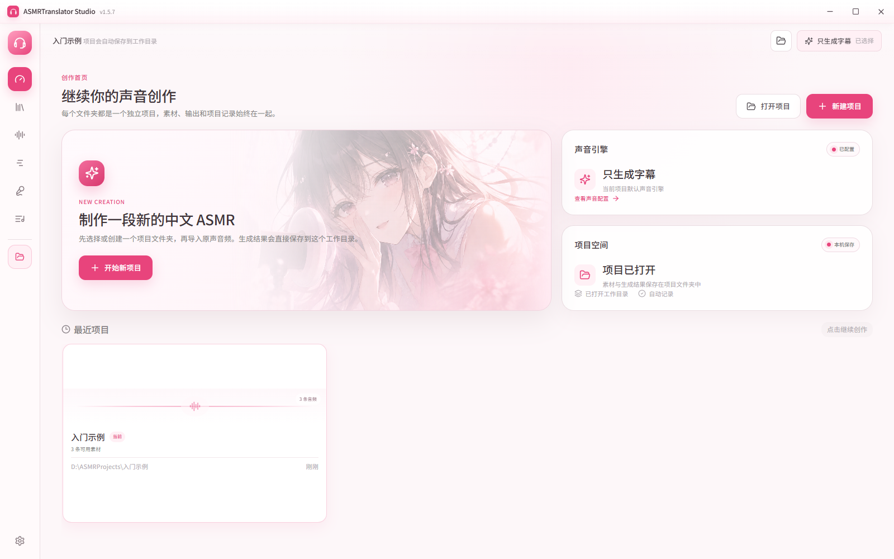

*首页：可直接选择音频或当前文件夹建立项目，最近项目可以直接打开继续处理。*

### 添加音频与字幕

1. 进入“项目”，点击“添加音频或文件夹”。选择单个文件只加入该音频；选择文件夹会加入扫描到的音频。
2. 可以重复添加，将不同位置的音频放进同一项目。
3. 检查每条音频的字幕状态。支持 `.vtt`、`.srt`、`.lrc`；已匹配的字幕可以更换，未匹配的音频可自动生成字幕。
4. 如果显示“字幕冲突”或“字幕丢失”，先手动选择正确的字幕文件。
5. 勾选一条音频后点击“单条转换”；勾选多条后点击“批量转换”，进入工作台统一配置。

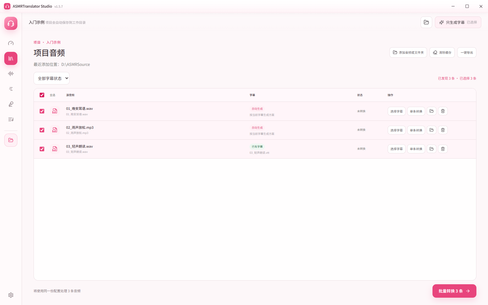

*项目页：导入、绑定字幕、勾选音频，再进入工作台。*

已有中文字幕时，确认它和当前音频内容、时间轴对应。只要字幕可直接用于配音，就不需要再次执行日语 ASR。

## 配置识别与翻译

没有字幕时，有“LLM + ASR”和“海南鸡直出”两条路径。它们都能为后续配音准备中文字幕。

### 方案一 LLM + ASR

**第一步，配置文字大模型。** 点击左下角“设置”，在“文字大模型”中填写：

| 字段 | 怎么填 |
| --- | --- |
| Provider | 按服务接口选择 OpenAI 兼容或 Anthropic |
| Base URL | 服务商提供的 API 地址，不是普通聊天网页地址 |
| 模型 | 当前账户可调用的准确模型名称 |
| API Key | 该服务平台创建的密钥 |

填写后点击“测试文字大模型连接”。截图中的地址和模型名是占位示例，请勿直接照抄。

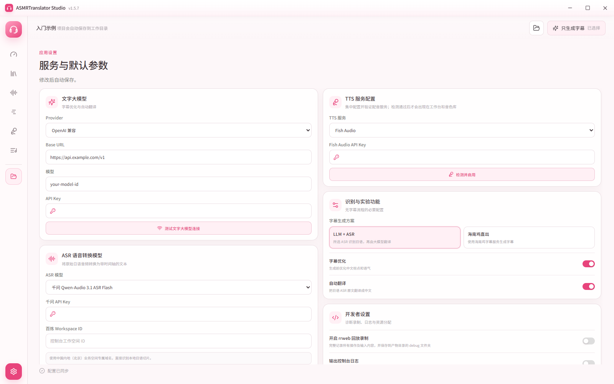

*设置页：文字大模型和语音识别分别配置，填完后分别测试。*

**第二步，选择 ASR。** 可以使用在线平台，也可以使用本地插件：

| ASR 选项 | 需要填写或准备 |
| --- | --- |
| Fish ASR | Fish Audio API Key |
| 千问 Qwen-Audio 3.1 ASR Flash | 千问 API Key + 对应百炼业务空间的 Workspace ID |
| 千问 Fun-ASR | 千问 API Key |
| 小米 MiMo-V2.5-ASR | MiMo ASR API Key；日语识别为实验功能 |
| MOSS Transcribe & Diarize | 安装并启动 MOSS 本地插件；可配合原生句子对齐与切分核验 |
| 通用 ASR 插件（自动识别） | 先安装并启动 Kotoba-Whisper 或 Parakeet，再选择插件并检测连接 |

使用本地 ASR 时，选择“本机”，在“已安装的通用 ASR 插件”中选择目标插件，点击“重新识别插件”和“检测 ASR 连接”。**已找到安装记录，只说明插件已安装，不表示模型已启动。** 图中展示的未就绪提示，需要先在安装器中启动插件后再检测。

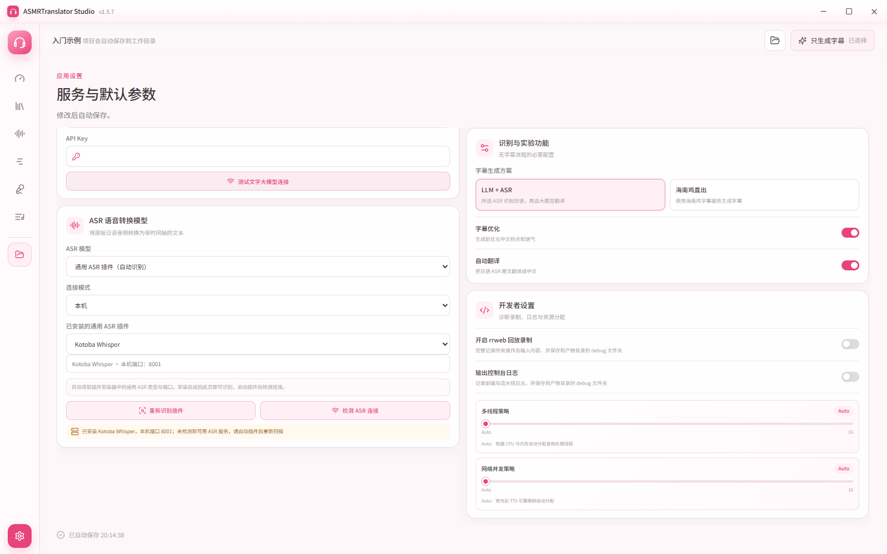

*本地 ASR：选择正确插件，确认模型已就绪。*

**第三步，开启自动翻译。** 在“识别与实验功能”中选择“LLM + ASR”，打开“自动翻译”。需要调整中文标点和语气时，再打开“字幕优化”。仅输出日语识别文本不能替代配音所需的中文字幕。

**按音频特点调整识别。** “人声检测与时间对齐”可选内置 FSMN VAD 或已安装的 **ASMR VAD 本地插件**；耳语较轻时可调低“人声阈值”，再检查误检。使用 MOSS 时，可开启“日语句子对齐 · Beta”，按可用方式选择对齐器，并按需启用“MOSS 切分核验 · Beta”。“识别与实验功能”的 **ASR 词级时间戳增强（ASR Boost）** 会在支持的 ASR 中先用词级时间戳划定细切区间，不支持的引擎会跳过。需要减少背景音对识别和参考音色的影响时，先启动 UVR 服务，再开启 **UVR 人声分析预处理**，填写地址并测试连接；成品仍使用原始音轨。

### 方案二 海南鸡直出

1. 在安装器中安装并启动 ChickenRice（海南鸡）。
2. 在主程序设置的“识别与实验功能”中选择“海南鸡直出”。
3. 本机模式点击“扫描本地插件”，然后“测试连接”；远程服务填写实际地址、端口和适用的 API Key。
4. 打开“海南鸡翻译”，由海南鸡输出中文字幕。如果关闭它，输出日语后仍需配置文字大模型翻译。
5. “海南鸡专属 VAD”用于选择海南鸡的人声检测；关闭时使用主程序提供的 VAD 时间轴。

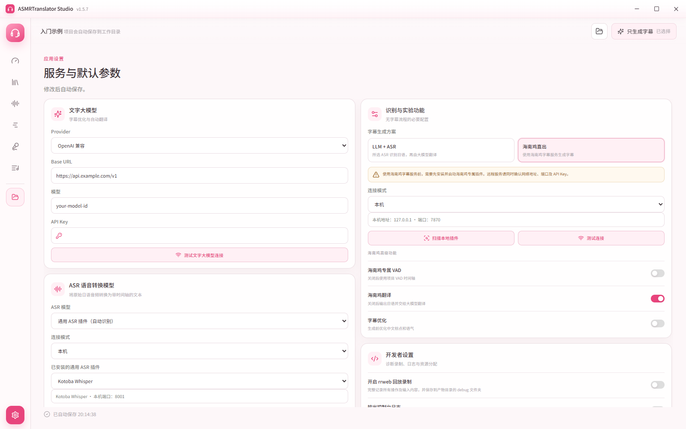

*海南鸡可以直出中文；是否仍需文字大模型，取决于是否开启海南鸡翻译，以及是否启用字幕优化。*

### 只生成中文字幕

素材准备好后，在工作台右侧“TTS 引擎”中选择“只生成字幕”。这是新配置的默认选项，不需要检测或启动任何 TTS 服务。

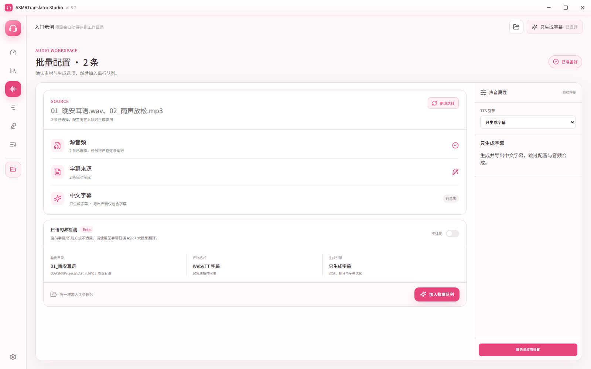

*只生成字幕会跳过配音与音频合成，最终导出 WebVTT 字幕。*

“日语句界检测 Beta”只在适用的无字幕日语 ASR + 大模型翻译流程中可用。显示“不适用”不代表配置出错；第一次可先保留默认设置。

## 选择配音引擎与音色

### 在线 TTS

| 引擎 | 使用方式 |
| --- | --- |
| Edge TTS | 直接在工作台选择，无需 API Key；选择中文音色，可设置语速与音高 |
| MiMo TTS | 在设置中填写 API Key 并“检测并启用”，再到工作台选择音色及支持的模式 |
| Fish Audio | 在设置中填写 API Key 并“检测并启用”，再选择可用的音色或音色 ID |
| MiniMax | 在设置中填写 API Key 并“检测并启用”，再选择模型和音色 |

除了 Edge TTS，其他配音服务需先在设置页检测启用，才会出现在工作台和音色库。修改连接配置后需要重新检测。

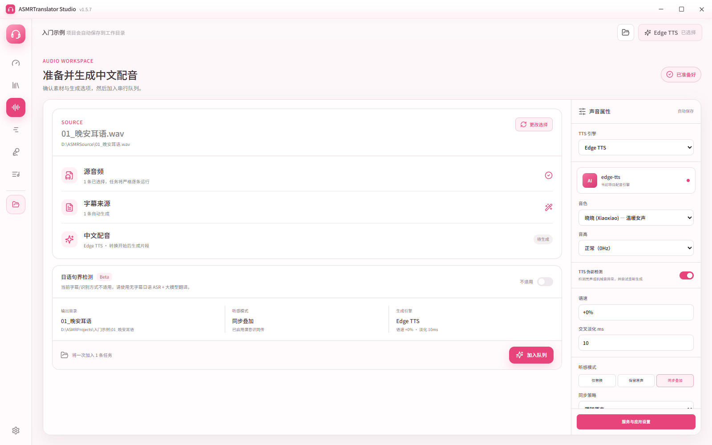

*工作台右侧选择引擎、音色和声音参数，面板可向下滚动查看听感设置。*

### 通用 TTS 插件

IndexTTS 和 Genie 已合并到“通用 TTS 插件”，不再使用旧版的独立引擎入口。

1. 在安装器中安装并启动目标 TTS 插件。
2. 主程序“设置”→“TTS 服务配置”，选择“通用 TTS 插件（自动识别）”。
3. 本机模式下，从“已安装的通用 TTS 插件”中选择 Audio8、IndexTTS 或 Genie；必要时点击“重新识别插件”。正常使用无需手动导入 YAML。
4. 点击“检测并启用”，通过后返回音频工作台。
5. 工作台“TTS 引擎”选择“通用 TTS 插件”，右侧显示当前插件自己的参数。

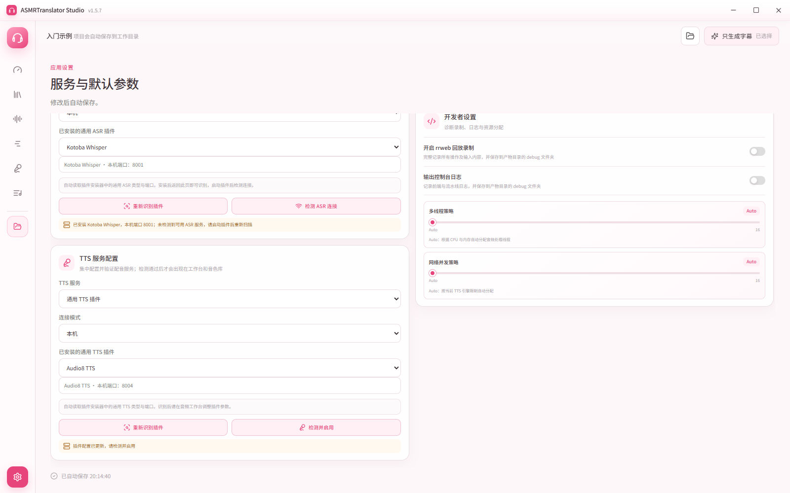

*设置页负责选插件和检测连接，工作台负责音色、参考素材与合成参数。*

服务器模式填写完整服务地址，例如 `http://192.168.1.10:7860`，按需填写 API Key，点击“重新识别插件”读取服务信息，然后检测启用。更换插件、端口或插件描述后，请重新检测；已排队任务保留入队时的配置。

### IndexTTS 2.5

默认“音色来源”为“自动使用每段原声”，情感控制也可逐段跟随原声，不需要额外上传参考录音。想让整段音色更一致，可切换到“使用固定音色参考”，再选择一段清晰的单人语音。

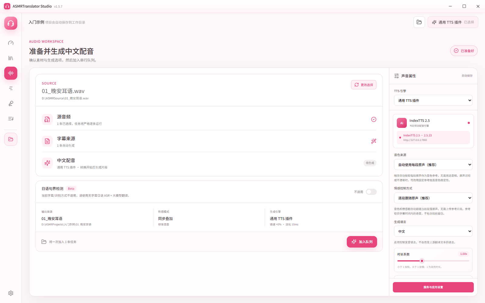

情感方式包括逐段跟随原声、跟随音色参考、独立情感参考、情感向量和情感描述。情感描述需要插件启动时加载情感文本模型；首次使用可保留默认参数。

IndexTTS 用“时长系数”控制语速：小于 `1` 加快，大于 `1` 放慢。生成语言只控制模型发音，不会替你把上游中文翻译成另一种语言。

### Audio8 TTS

选择并裁切一段参考音频，同时填写**这段选区实际说出的文字**。参考文字不是本次待合成的中文字幕；调整选区后，要同步修改文字。该插件按当前段中文字幕合成，不支持通用语速、音高的非默认值。

### Genie TTS

在工作台选择已训练的 GPT `.ckpt` 和 SoVITS `.pth` 权重，上传参考音频，选择参考语种并填写对应台词。参考录音按插件要求准备为 3–10 秒；主程序编辑器允许 3–15 秒选段，使用 Genie 时仍应遵守其更短的范围。

首次合成时会自动转换模型，后续可复用转换结果。新版无需先手动转换为 ONNX。模型需为支持的 GPT-SoVITS V2 / V2Pro / V2ProPlus 配套权重，模型路径必须对插件服务可访问。

### 音色库能做什么

在左侧“音色库”中查看可用平台音色；支持的服务还可进行音色设计、克隆或管理收藏。平台功能和账号权限各有不同。通用插件的模型路径与参考音频应在工作台按该插件的参数配置。

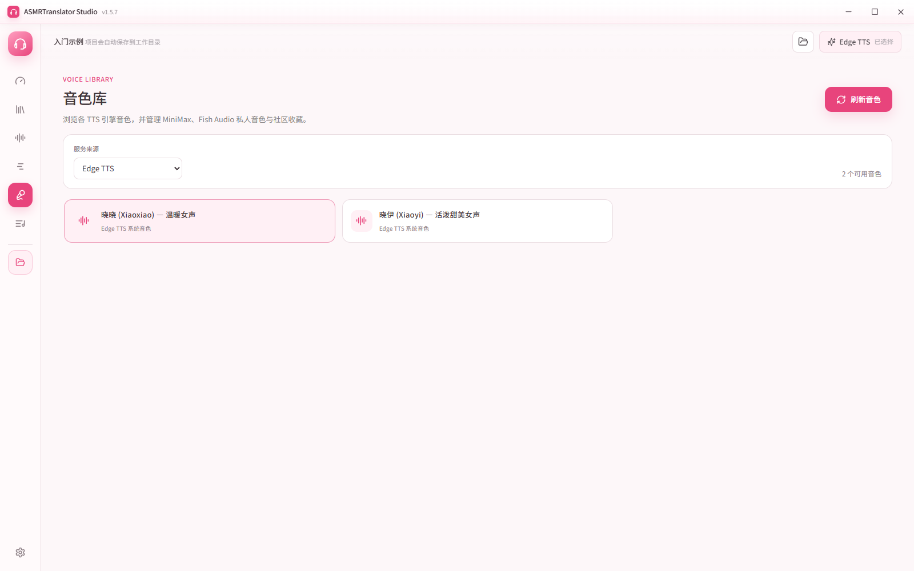

*音色库用于浏览与管理音色；部分平台操作会调用其在线服务。*

## 试听和裁切参考音频

1. 先打开项目，在工作台点击插件的音频选择按钮。
2. 选择清晰的单人语音，打开参考音频编辑器。
3. 拖动两端调整范围，也可直接输入起点和终点；点击“播放选段”试听。
4. 点击“确定”，将选段保存到当前项目；取消则保留原设置。

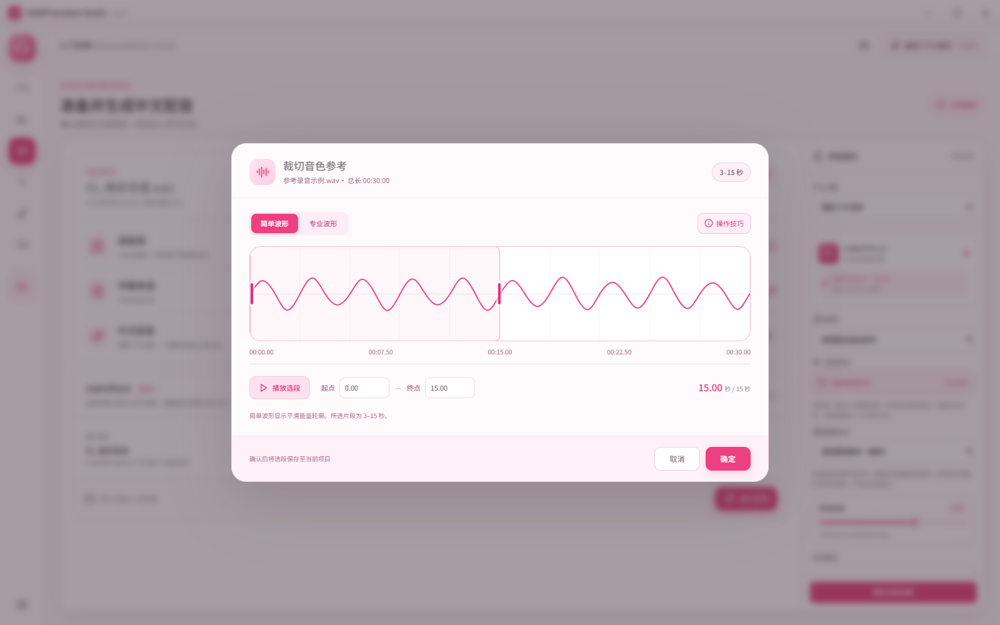

*图中为示例波形。实际使用时应检查选区里的说话内容、背景音和时长。*

编辑器支持简单波形与专业波形切换，滚轮围绕鼠标位置缩放，左键拖动平移视野，中键拖动移动选区，左键拖动选区两端调整时长。右上角“操作技巧”可随时查看。

一般选段范围为 3–15 秒；不足 3 秒的文件不能用作手动参考。插件有更严格要求时，以插件为准。选段会缓存到项目中，保存后无需继续依赖原参考文件；如果项目内缓存丢失或损坏，重新选择录音并裁切即可。

## 选择听感模式

在工作台右侧向下滚动，找到“听感模式”。

| 模式 | 听起来是什么效果 |
| --- | --- |
| 仅替换 | 对应原声片段换成中文配音 |
| 保留原声 | 保留原声，再插入中文翻译，便于对照 |
| 同步叠加 | 中文配音与原声同时播放 |
| 潜意识同传 | 在同步叠加基础上增加延迟、混响与柔化效果 |

“潜意识同传”是同步叠加下的开关。可以调整起播延迟、混响强度、齿音柔化、原声淡化与尾声淡化。

同步叠加还可选择“跟随原声”或“跟随翻译”：前者通过限制范围内的加速尽量匹配原声时长，后者允许按设定延长空白，超出限制时可能截断。先听一小段，再调整到自己能接受的节奏。

“翻译音量”100% 表示按原声响度匹配后的正常音量；想让中文更轻可适当调低。“交叉淡化”用于缓和片段衔接。插件不支持的语速、音高请保持默认，不要强行套用在线 TTS 的参数。

## 音频编排工作台

先完成一次带配音的任务，再从“输出结果”点击“音频编排”；也可从“音频工作台”进入，在顶部选择已生成的音频。页面左侧显示片段和波形，底部是片段时间线，右侧“片段检查器”保存字幕与配音设置。下图使用示例字幕和示例波形演示操作。

### 查看全局分段与保留原声双时间轴

1. 在底部“片段时间线”点击句子卡片定位，顶部可用“上条音频 / 下条音频”切换片段；同源粗切的多句会标明所属分组。
2. 用“声音总览”右侧的图层按钮依次切换当前片段、全局片段、片段与边界视角，检查整轨原声中的句子块及各句配音落点。用“专业波形”查看更细的峰值；拖动波形或滚轮可调整可视范围。
3. 选择“保留原声”听感模式时，原声块与 TTS 块在独立的双时间轴上排列。拖动块或边界调整位置、起止时间；底部可点击空区间单独调整，顶部“空区间”可在选中块后加入静音。右键片段可分别删除或恢复原声、TTS；“全局还原”可找回已删片段或恢复原始编辑。
4. 使用各轨播放键试听单句、用“声音总览”试听当前组合，或用整轨播放键检查片段之间的过渡。先听衔接，再保存编排草稿。

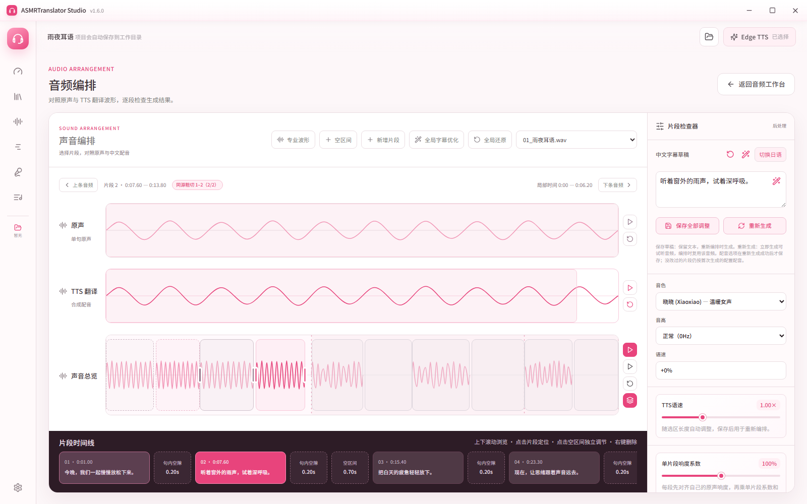

*示例项目：粉色为选中的句子及配音区域，底部同时显示句内空隙和段间空区间。*

### 逐句调整字幕与 TTS 参数

点击片段后，在右侧直接改“中文字幕草稿”，也可切换日语原文并使用单句优化。当前句可以单独选音色、音高、语速和引擎支持的其他参数；“TTS语速”随时间选区变化，“单片段响度系数”只影响当前句，也可切换为全局调节。“新增片段”会在当前分组中插入空白 TTS 片段，填入中文字幕后可生成。

“保存全部调整”保存文字与编排草稿，留待重新编排时生成；“重新生成”立即合成当前句供试听，成功后才保存这句的配音参数。没有改过的片段沿用首次生成时的配置。确认各句后点击右下角“重新编排”，任务会进入队列并复用可用缓存。

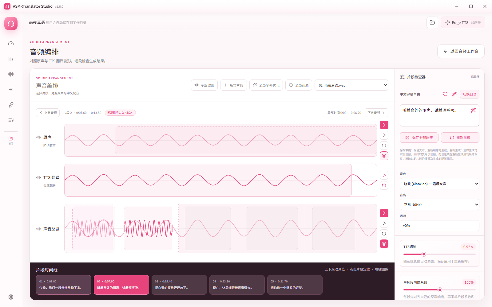

*右侧检查器显示当前句的音色、音高、语速和响度；底部时间线可快速切换句子。*

### 用指令优化整段字幕

点击顶部“全局字幕优化”，在“优化要求”中写清想要的处理方式，例如合并明显被错误拆开的短句、删除无意义语气词、修正标点，同时保持人物关系和原意。确认后检查各句文本与分组；需要回退时使用“全局还原”选择字幕或片段。优化会修改草稿，最终配音仍需按需“重新生成”当前句，或点击“重新编排”生成完整音频。

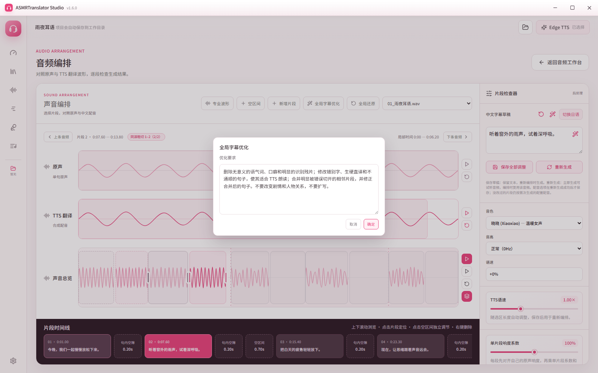

*示例指令仅用于说明输入方式；运行前按实际音频内容调整要求。*

### 快捷键与鼠标操作

#### 键盘快捷键

| 按键 | 适用位置 | 说明 |
| --- | --- | --- |
| `Q` | 全局（非输入框聚焦时） | 切换到上条音频片段 |
| `E` | 全局（非输入框聚焦时） | 切换到下条音频片段 |
| `Esc` | 全局 | 关闭当前打开的「全局还原」菜单、片段/空区间右键菜单或「全局字幕优化」弹窗 |
| `←` / `→` | 聚焦波形切割边界或时间轴区间边界手柄时 | 以 **10 ms** 为步长微调起止时间或区间边界 |
| `Shift + ←` / `Shift + →` | 聚焦波形切割边界或时间轴区间边界手柄时 | 以 **100 ms** 为步长快速调整起止时间或区间边界 |

#### 鼠标操作（左键 / 中键 / 右键 / 滚轮）

| 鼠标操作 | 适用位置 | 说明 |
| --- | --- | --- |
| **左键点击** | 声音总览同组片段 / 底部「片段时间线」 | 点击总览中的相邻片段或底部时间线卡片，可直接切换到对应片段；在「保留原声」模式下点击空区间卡片可单独调节该空区间 |
| **左键拖动** | 局部波形边界 / 声音总览区间边界 / 总览空白或主体 | 拖动左右边界可调整切割起止点、TTS 区间时长（联动语速）或空区间边界；拖动总览空白处或区间主体可平移当前时间轴视野 |
| **中键拖动** | 局部波形选区 / 声音总览区间主体 | 整体平移当前切割选区或声音区间位置；在「保留原声」双时间轴中支持把原声块与 TTS 块拖动到重叠位置 |
| **右键点击** | 声音总览区间 / 底部「片段时间线」 | 在声音总览的 TTS 区间或双时间轴片段上右键可查看/调试响度与过渡曲线详情；在底部片段或空区间卡片上右键可打开快捷菜单（删除片段，或在「保留原声」模式下分别删除/恢复原声、TTS 或删除空区间） |
| **滚轮滚动** | 声音总览 / 底部「片段时间线」 | 在声音总览中缩放或浏览视野；在底部时间线上下滚动滚轮可横向浏览全部片段 |

## 提交任务与查看日志

确认音频、字幕方案、引擎与听感后，点击“加入队列”或“加入批量队列”。软件先检查本次任务需要的服务；“只生成字幕”会跳过 TTS 检查。

检查失败时，根据提示前往设置修正，也可以选择仍然加入队列；服务未准备好时，实际运行仍可能失败。入队会保存本次配置，之后修改工作台不会自动修改已排队任务。

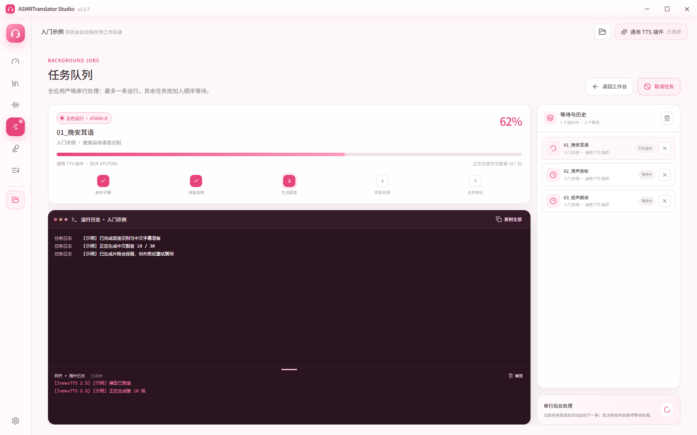

*任务队列使用示例进度展示：右侧选择任务，左侧查看该任务的阶段和日志。*

- **队列顺序**：全应用同时运行一条音频任务，其余按顺序等待；单条任务内部可按配置并发处理片段。
- **阶段进度**：识别、翻译、配音、声音处理、合并导出需要不同时间，不要仅凭一段时间没有新日志判断卡死。
- **失败与重试**：部分片段失败后，会继续尝试同阶段其他片段，再报告失败；重试时可复用成功结果，并不表示失败片段已经成功导出。
- **批次失败**：按队列提供的操作重试、跳过或停止后续任务。
- **复制日志**：“复制全部”用于反馈问题；插件控制台清理按钮只清空显示，本次运行之前的记录仍可复制，退出程序后释放。

如果修改了源音频、字幕、音色或参数，并希望完全重新处理，请在项目页勾选对应音频，点击“清除缓存”，再提交任务。清理会删除中间识别、翻译、配音等缓存，保留源音频、手动字幕、最终成品、诊断日志和已导出文件；有活动任务时不能清理。

## 查看结果与批量导出

### 查看单条结果

完成后进入“输出结果”，点击生成文件，或“打开输出目录”。

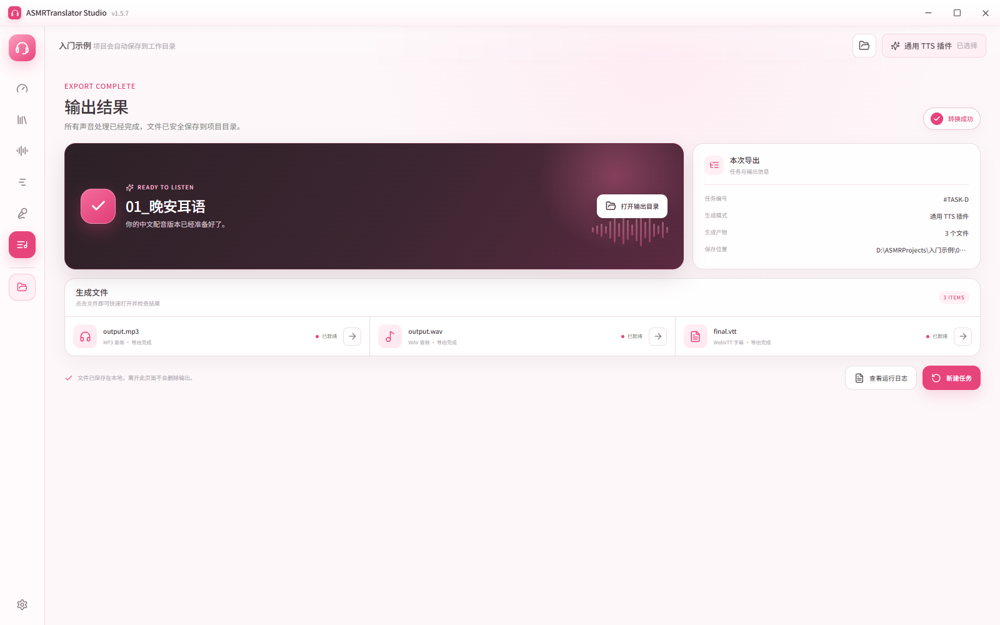

*配音模式展示 MP3、WAV 和字幕；只生成字幕时不会出现配音文件。*

项目的字幕、编排草稿、缓存和运行记录统一存于 `generated/project.sqlite3`，实际生成音频位于 `generated/`。需要独立的 WebVTT 文件时使用导出功能；以结果页列出的实际产物为准。旧版项目的 JSON、VTT 等分散文件不能直接作为 v1.6.0 项目数据使用。

### 整个项目一键导出

在结果页或“项目”页点击“一键导出”，集中整理已完成音频和 WebVTT 字幕，并生成导出清单。只生成字幕的任务只导出字幕；未完成或缺少产物的音频会跳过。若在设置的“识别与实验功能”开启“导出高音质”，新任务导出时会从原音频重建合成，MP3 尽量匹配原码率、WAV 保留原采样率和位深；旧任务需重新生成。导出 MP3 时还会保留原音频标签，并从项目目录匹配封面图片嵌入。

一键导出主要用于整理可交付文件，不会打包全部模型、中间缓存或参考素材。导出后使用“打开导出文件”核对音频、字幕和封面。

## 常见问题与处理方法

| 问题 | 先检查什么 |
| --- | --- |
| 工作台没有想用的 TTS | 先在设置页选择对应服务并“检测并启用”；IndexTTS、Genie、Audio8 在通用 TTS 内选择 |
| 找不到已安装插件 | 确认安装已完成，点击重新识别；升级安装器 2.0 后按要求重新安装插件 |
| 插件已识别但连接失败 | 在安装器中启动服务，等待模型加载，核对实际端口后重新检测 |
| 本地 ASR 提示未就绪 | 检查模型是否启动成功；Kotoba 和 Parakeet 需要受支持的 NVIDIA GPU，不能回退 CPU |
| API 连接失败或限流 | 核对接口地址、模型名称、API Key、账户额度和网络；同时看具体错误提示 |
| 千问 ASR 配好 Key 仍失败 | Qwen-Audio 3.1 ASR Flash 还需要对应百炼 Workspace ID；Key 与业务空间配置需匹配 |
| 字幕还是日语 | LLM + ASR 路径检查自动翻译与大模型配置；海南鸡路径检查海南鸡翻译开关 |
| 内存或显存不足 | 停止其他模型服务；在支持的插件中改用 CPU 或合适精度，然后重启并检测 |
| Audio8 提示参考素材缺失 | 选择并裁切参考音频，填写与选区完全一致的参考文字 |
| Genie 转换或加载失败 | 检查 GPT / SoVITS 权重是否配套、模型类型是否支持、路径是否对服务可访问 |
| 修改设置后队列仍用旧参数 | 已入队任务保留配置快照；取消后按新配置重新入队 |
| 重试仍在复用旧结果 | 如需全部重新生成，等任务结束后清除该音频缓存，再提交 |
| 输出里没有 MP3 | 检查是否选择“只生成字幕”；该模式只输出字幕 |

反馈问题时，说明主程序与插件版本、使用的引擎、操作步骤、失败阶段和完整错误信息，附任务日志与必要的插件日志。发送截图和日志前，遮住 API Key 等凭据。

## 操作技巧与服务入口

- `Ctrl + 鼠标滚轮`：缩放界面；`Ctrl + 0`：恢复默认缩放。
- 最近项目可以右键“从最近项目中删除”，只移除入口和关联的应用记录，不会删除本地项目文件。
- 设置修改后自动保存；项目保存自己的配音配置，参考音频选段也保存在项目中。
- 更换插件后检查右侧参数是否符合当前模型，并重新检测启用，再提交新任务。

### 在线服务官方入口

| 服务 | 官方入口 | 在软件中的用途 |
| --- | --- | --- |
| 文字大模型 | [DeepSeek API 文档](https://api-docs.deepseek.com/zh-cn/)或你所用服务商的 API 文档 | 按文档取得 Base URL、模型名称与 API Key |
| Fish Audio | [官方文档](https://docs.fish.audio/) | ASR、TTS 与支持的音色功能 |
| 阿里云百炼 | [获取与配置 API Key](https://help.aliyun.com/zh/model-studio/get-api-key) | 千问 ASR 的密钥；Qwen-Audio 另需业务空间信息 |
| 小米 MiMo | [开放平台](https://platform.xiaomimimo.com/) | 按所用 ASR / TTS 服务配置相应凭据 |
| MiniMax | [开放平台](https://platform.minimax.io/) | 获取 TTS 凭据与查看账号可用模型 |

平台网页和模型范围可能调整，按当前官方文档填写，最后以主程序的连接检测与实际任务结果确认可用性。

[返回项目首页](README.md)
